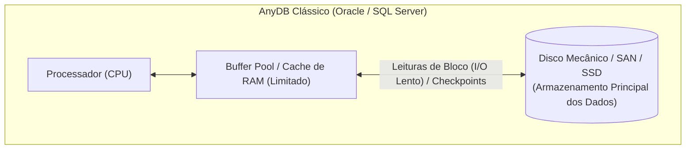
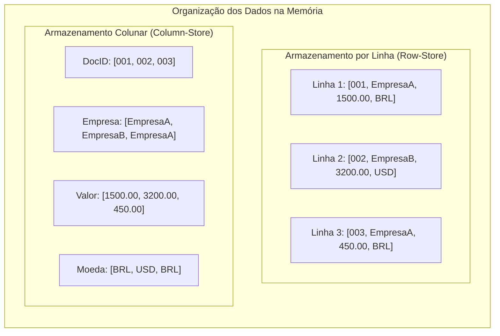
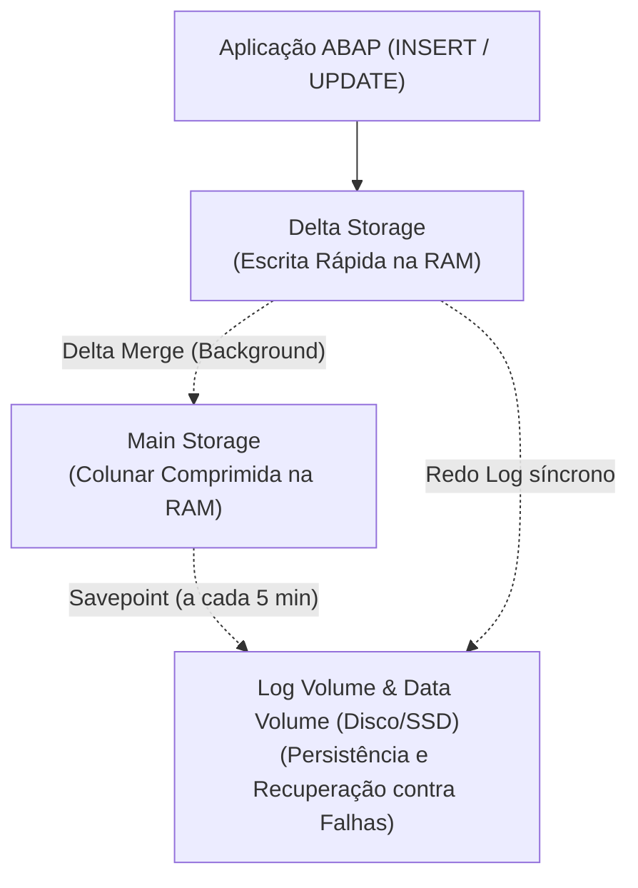

# Arquitetura do SAP HANA: Banco In-Memory, Armazenamento Colunar e HTAP

## 1. Contexto no SAP ECC (Como Funcionava Antes)

No modelo tradicional do SAP ECC sobre bancos relacionais clássicos (*AnyDB* como Oracle, Microsoft SQL Server ou IBM DB2), a engenharia de software do banco de dados era estritamente baseada em **armazenamento por linhas (*Row-Store*) e persistência prioritária em disco mecânico**:

### Características e Gargalos do Modelo Legado (Row-Store em AnyDB)
1. **Armazenamento por Linhas (*Row-Store*)**: Todos os campos de uma tupla/linha contábil ou logística são gravados sequencialmente no bloco de disco. Exemplo: se uma consulta precisa apenas da soma do campo `DMBTR` (Montante em moeda interna) da tabela `BSEG`, o banco era obrigado a carregar do disco todos os outros 300+ campos da linha (`BELNR`, `BUKRS`, `GJAHR`, `KOART`, `MATNR`, etc.).
2. **Gargalo Brutal de Entrada/Saída (*I/O Bottleneck*)**: Discos magnéticos introduzem latência de busca física (*seek time*). Leituras massivas para apurações contábeis de final de mês ou balancetes levavam horas, saturando o barramento de I/O.
3. **Multiplicação Artificial de Índices e Agregados**: Para que relatórios financeiros não realizassem *Full Table Scans* de milhões de linhas em disco, criavam-se dezenas de índices secundários e tabelas agregadas (`GLT0`, `KNC1`, `LFC1`). Todavia, cada índice penalizava severamente as operações de gravação (`INSERT`, `UPDATE`), exigindo bloqueios de tabela (*locks*) e gerando concorrência destrutiva.
4. **Separação Obrigatória entre OLTP e OLAP**: Como relatórios analíticos pesados derrubavam a performance transacional do ERP de produção, as empresas eram forçadas a extrair dados via processos noturnos de ETL (*Batch*) para bancos analíticos dedicados, como o **SAP BW (Business Warehouse)**.

---

## 2. O Que Mudou no SAP S/4HANA (Arquitetura e Conceito)

O **SAP HANA** é um banco de dados relacional voltado a objetos, completamente desenhado do zero para manter **100% dos dados operacionais diretamente na memória física (RAM)** e utilizar primariamente o modelo de **armazenamento colunar (*Column-Store*)**:

### Principais Pilares Arquiteturais do SAP HANA

#### A. Armazenamento Colunar (*Column-Store*)
Em vez de gravar linhas completas contíguas, o HANA grava cada coluna contiguamente na memória:
- **Leitura Seletiva em Alta Performance**: Se o relatório pede `SUM(DMBTR)`, a CPU do servidor acessa exclusivamente o vetor contínuo correspondente àquela coluna na memória RAM.
- **Processamento Vetorizado com Instruções SIMD**: Processadores modernos aplicam uma única instrução computacional sobre múltiplos dados em paralelo (*Single Instruction, Multiple Data*), permitindo que o HANA some centenas de milhões de valores em frações de segundo.

#### B. Taxas Agressivas de Compressão de Dados
Em sistemas corporativos, dados em colunas apresentam imensa repetitividade (por exemplo, códigos de empresa como `1000`, códigos de status, centros ou moedas). O SAP HANA aplica algoritmos avançados de compressão em memória:
- **Dicionário de Codificação (*Dictionary Encoding*)**: Strings e valores repetidos são convertidos em números inteiros minúsculos indexados em um dicionário compacto.
- **Run-Length Encoding (RLE), Cluster e Sparse Encoding**: O volume de dados bruto de um banco ECC sobre Oracle de 5 TB frequentemente é reduzido para **800 GB a 1.2 TB** na memória RAM do HANA (fator médio de compressão entre 4x e 6x).

#### C. HTAP: Unificação Transacional (OLTP) e Analítica (OLAP)
O HANA viabiliza o conceito de **Hybrid Transactional and Analytical Processing (HTAP)**. Uma única base de dados executa transações críticas de milissegundo (vendas, faturamento, recebimento) e, simultaneamente, alimenta dashboards executivos e fechamentos contábeis analíticos em tempo real, sem necessidade de replicação de dados.

#### D. Mecanismo de Escrita: Memória Principal (*Main*) e Memória Delta (*Delta Store*)
Uma dúvida clássica de quem vem do mundo relacional é: *"Como o banco colunar consegue fazer INSERTs rápidos se as colunas estão gravadas separadas?"*
A resposta reside na separação arquitetural da tabela no HANA:
1. **Delta Storage**: Uma área de escrita rápida, otimizada para inserções imediatas (gravação orientada a linha/buffer).
2. **Main Storage**: A área colunar compactada e otimizada para leitura e agregação analítica.
3. **Delta Merge**: Processo em background gerenciado pelo HANA que transfere e consolida periodicamente as alterações da *Delta Store* para a *Main Store* sem interromper as operações do usuário.

---

## 3. Impacto Prático na Migração e Armadilhas Reais de Projetos

### O Falso Mito: "Não Precisa Mais de Chave Primária nem Performance no Código"
Com a velocidade do HANA, muitos desenvolvedores ABAP adotam a falsa premissa de que qualquer código mal escrito rodará rápido. Isso causa severos problemas em produção:
- **Ordenação Implícita Eliminada**: Em bancos de dados tradicionais (Oracle), quando se executava um `SELECT` em uma tabela, o banco frequentemente retornava os registros na ordem do índice primário. **No SAP HANA colunar, os dados NÃO possuem ordenação física implícita.** Programas Z que dependiam da ordem sem usar cláusula explícita `ORDER BY` ou `SORT` em tabela interna começam a gerar cálculos errados ou inconsistências funcionais.
- **Transferência Desnecessária de Dados (*Code-to-Data Paradigm*)**: O erro mais comum do programador ECC é trazer milhares de registros do banco para a camada de aplicação ABAP com `SELECT ... INTO TABLE lt_dados` e fazer somatórias em loops `LOOP AT lt_dados`. No S/4HANA, adota-se o paradigma **Code Pushdown**: o cálculo deve ser empurrado para o HANA via **CDS Views** (*Core Data Services*) e agregação nativa.

### Armadilhas Reais de Projetos (*Gotchas*)

!!! danger "Armadilha 1: Queda de Energia e Reinicialização do Servidor HANA"
    *"Se o banco está na memória RAM, o que acontece se o servidor reiniciar?"*  
    O HANA persiste cada transação imediatamente em disco SSD (*Redo Log*) e gera pontos de checagem completos (*Savepoints*) a cada 5 minutos. Porém, ao reiniciar um servidor HANA com 4 TB de RAM, o processo de recarga (*Reload*) de todas as tabelas colunares do disco para a RAM pode demorar entre **30 minutos e 2 horas**. Para mitigar esse tempo em janelas de manutenção, é essencial configurar o pré-carregamento prioritário de tabelas críticas (*Table Preload*).

!!! warning "Armadilha 2: Consumo Descontrolado de Memória (*Out of Memory - OOM*)"
    Consultas Z mal parametrizadas (ex: produto cartesiano sem junção adequada em tabelas com centenas de milhões de registros como a `ACDOCA`) podem alocar temporariamente 500 GB de memória de trabalho. Se o limite de alocação de memória for atingido, o serviço central do HANA (`hdbnameserver` / `hdbindexserver`) pode disparar eventos de *Out of Memory (OOM)* e derrubar transações ativas de outros usuários.

!!! tip "Armadilha 3: Delta Merge Travado"
    Tabelas com altíssima taxa de transação que não conseguem executar o *Delta Merge* acumulam milhões de registros na *Delta Store*. Isso degrada drasticamente a performance de leitura. Monitore rotineiramente a transação `DB02` ou a ferramenta **SAP HANA Cockpit** para verificar tabelas com *Delta Storage* inflado.

---

## 4. Tabela de Referências Cruzadas

### Links Internos na Wiki
- [O que é o S/4HANA e Modelos de Nuvem](o-que-e-s4hana.md)
- [Universal Journal (Tabela ACDOCA)](../02-de-para-tecnico/universal-journal-acdoca.md)
- [Logística Simplificada (Tabela MATDOC)](../02-de-para-tecnico/logistica-matdoc-sd.md)
- [Kit de Ferramentas Técnicas (SUM com DMO)](../03-estrategias-e-ferramentas/kit-ferramentas.md)

### Links Oficiais e Notas SAP
- **SAP Note 1999997**: *FAQ: SAP HANA Memory*.
- **SAP Note 2057595**: *FAQ: SAP HANA High Availability*.
- **SAP Note 2222250**: *FAQ: SAP HANA Delta Merge*.
- [SAP HANA Administration Guide - Help Portal](https://help.sap.com/viewer/product/SAP_HANA_PLATFORM/)
- [SAP Community: Top Guidelines for ABAP on HANA Performance](https://community.sap.com/topics/abap-development)
