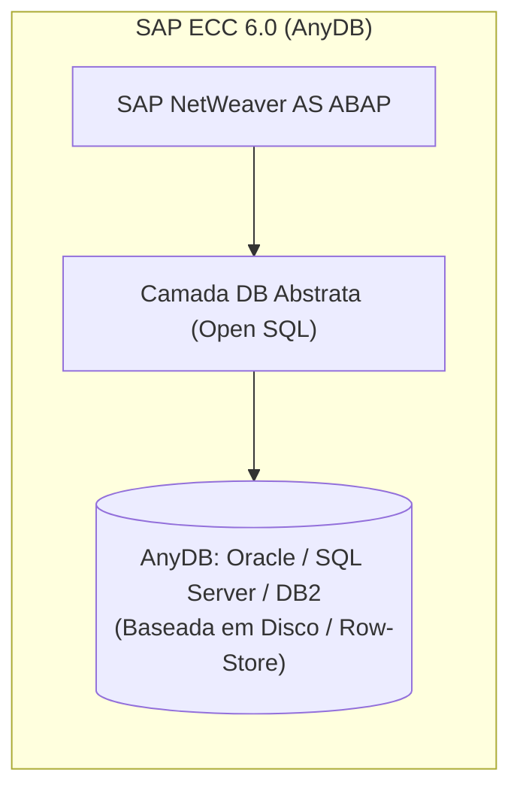
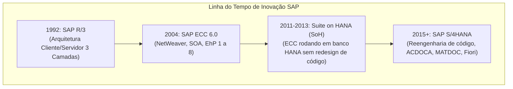
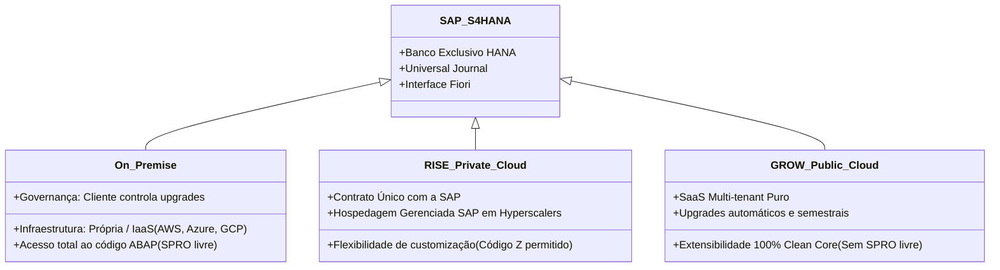

# O Que é o SAP S/4HANA: Evolução, Modelos e Estratégia de Nuvem

## 1. Contexto no SAP ECC (Como Funcionava Antes)

No modelo clássico do **SAP R/3** e, posteriormente, do **SAP ECC 6.0 (Enterprise Central Component)**, a arquitetura de software da SAP foi concebida sob o paradigma da década de 1990 e início dos anos 2000:

- **Independência de Banco de Dados (*AnyDB*)**: O SAP ECC foi projetado para rodar sobre qualquer sistema gerenciador de banco de dados relacional (RDBMS) do mercado, como **Oracle Database, Microsoft SQL Server, IBM DB2, MaxDB ou Sybase ASE**.
- **Limitação de Disco e I/O**: Devido ao custo elevado e à baixa velocidade de leitura/escrita em discos mecânicos (*spinning disks*) e memórias RAM da época, o modelo relacional era normalizado para transações rápidas (OLTP), mas sofria severamente em relatórios analíticos complexos (OLAP).
- **Tabelas Agregadas e Redundância**: Para contornar a lentidão na agregação de milhões de linhas em disco, o SAP ECC introduziu centenas de tabelas de índices secundários e totais pré-calculados (ex: `GLT0`, `KNC1`, `LFC1`, `BSIS`, `BSAS`). Cada transação de gravação precisava atualizar não apenas o documento contábil, mas também dezenas de tabelas periféricas de índice e saldo.
- **Modelo de Licenciamento Tradicional On-Premise**: O cliente adquiria licenças perpétuas de software, financiava seu próprio hardware (físico ou virtualizado em datacenter próprio/colocation) e pagava manutenção anual de 22% sobre a base instalada.

---

## 2. O Que Mudou no SAP S/4HANA (Arquitetura e Conceito)

O **SAP S/4HANA** (abreviação de *SAP Business Suite 4 SAP HANA*) representa uma ruptura fundamental com o passado:

1. **Exclusividade do SAP HANA**: O S/4HANA **não roda** em Oracle, SQL Server ou DB2. Ele foi completamente reescrito para explorar com exclusividade as capacidades do banco de dados in-memory colunar **SAP HANA**.
2. **Eliminação de Agregados e Redundâncias**: Com a velocidade in-memory do SAP HANA, agregações de milhões de registros ocorrem em milissegundos *on-the-fly*. Portanto, todas as tabelas de totais acumulados e índices redundantes foram sumariamente eliminadas.
3. **Fusão de OLTP e OLAP (HTAP)**: Transações operacionais e relatórios analíticos executam em tempo real sobre a mesma base de dados, eliminando a dependência histórica de extrações batch noturnas para data warehouses (como o SAP BW).

### Modelos de Implantação: On-Premise vs Nuvem (RISE e GROW)

Atualmente, o SAP S/4HANA é comercializado em modalidades distintas que determinam a flexibilidade de customização e a responsabilidade de infraestrutura:

| Critério de Comparação | S/4HANA On-Premise | S/4HANA Cloud, Private Edition (RISE) | S/4HANA Cloud, Public Edition (GROW) |
| :--- | :--- | :--- | :--- |
| **Modelo Comercial** | Aquisição perpétua de licença + manutenção anual | Assinatura (SaaS/IaaS unificado sob contrato SAP) | Assinatura (SaaS multi-tenant puro) |
| **Infraestrutura** | Datacenter do cliente ou IaaS próprio (AWS/Azure/GCP) | Gerenciada pela SAP no Hyperscaler escolhido | Nuvem pública operada diretamente pela SAP |
| **Acesso ao Customizing (SPRO)** | Total e irrestrito | Total (com incentivo a práticas de Clean Core) | Restrito via *SAP Central Business Configuration (CBC)* |
| **Modificação de Código ABAP (Z\*)** | Livre (acesso total à SE38/SE80) | Livre, com suporte ao ABAP Cloud e extensibilidade clássica | Apenas **ABAP Cloud / Developer Extensibility** |
| **Ciclo de Atualização / Upgrades** | Definido pelo cliente (a cada 2 a 5 anos) | Calendário negociado com a SAP (suporte padrão de 5 anos) | **Mandatório e automatizado** (ciclos contínuos) |

---

## 3. Impacto Prático na Migração e Armadilhas Reais de Projetos

### A Ilusão do "Upgrade Simples"
Muitos executivos e gestores de TI acostumados com a passagem de ECC 6.0 EhP 7 para EhP 8 acreditam que migrar para o S/4HANA seja apenas aplicar Support Packages. Trata-se de uma falácia grave:
- O S/4HANA descontinua centenas de funcionalidades do ECC documentadas no **Simplification Item Catalog**.
- Processos legados consolidados (como transações clássicas de cliente `XD01` e fornecedor `XK01`) **deixam de funcionar**, exigindo adaptação funcional obrigatória para **Business Partner (CVI)**.
- O código Z existente que faz leituras diretas em tabelas de agregados ou que usa comandos obsoletos (`SELECT * FROM BSEG` sem chaves completas) sofre degradação severa ou erros de sintaxe.

### Armadilhas Reais de Projetos (*Gotchas*)

!!! danger "Armadilha 1: Escolha Equivocada entre Private Cloud e Public Cloud"
    Tentar migrar um ECC legado altamente customizado (com milhares de programas Z e modificações no standard) diretamente para o **S/4HANA Public Cloud (GROW)** por conversão de sistema (*Brownfield*) é tecnicamente **impossível**. O Public Cloud exige nova implementação (*Greenfield*) e aderência rigorosa ao *Standard*. Para conversão direta de sistema herdado, a única opção é **On-Premise** ou **Private Cloud (RISE)**.

!!! warning "Armadilha 2: O Fim do Suporte ao SAP ECC em 2027"
    A SAP estabeleceu o encerramento do suporte padrão ao SAP ECC 6.0 para **31 de dezembro de 2027** (com extensão opcional e onerosa até 2030). Projetos de migração complexos demoram entre 12 e 24 meses; portanto, postergar a fase de planejamento coloca a empresa sob alto risco de escassez de consultores qualificados e multas de suporte estendido.

!!! tip "Armadilha 3: Dimensionamento do Hardware HANA (Sizing)"
    No ECC, a base em disco crescia sem restrições extremas de custo. No SAP HANA, a memória RAM é o elemento de maior custo. Realizar o dimensionamento (*HANA Sizing*) sem uma rotina prévia e agressiva de **expurgo e arquivamento de dados históricos (Data Archiving)** pode triplicar o custo de infraestrutura no S/4HANA.

---

## 4. Tabela de Referências Cruzadas

### Links Internos na Wiki
- [Arquitetura SAP HANA (In-Memory, Colunar e HTAP)](arquitetura-hana.md)
- [SAP BTP & Paradigma de Clean Core](sap-btp-e-clean-core.md)
- [Universal Journal e a Tabela ACDOCA](../02-de-para-tecnico/universal-journal-acdoca.md)
- [Abordagens de Migração: Brownfield vs Greenfield](../03-estrategias-e-ferramentas/abordagens-migracao.md)

### Links Oficiais e Notas SAP
- **SAP Note 2269324**: *Compatibility Scope Matrix for SAP S/4HANA*.
- **SAP Note 2758146**: *SAP Readiness Check for SAP S/4HANA - Composite Note*.
- [SAP Help Portal - S/4HANA Product Page](https://help.sap.com/viewer/product/SAP_S4HANA_ON-PREMISE/)
- [SAP Simplification Item Catalog Online](https://launchpad.support.sap.com/#/sic/)
- [RISE with SAP - Visão Geral Oficial](https://www.sap.com/products/erp/rise.html)
