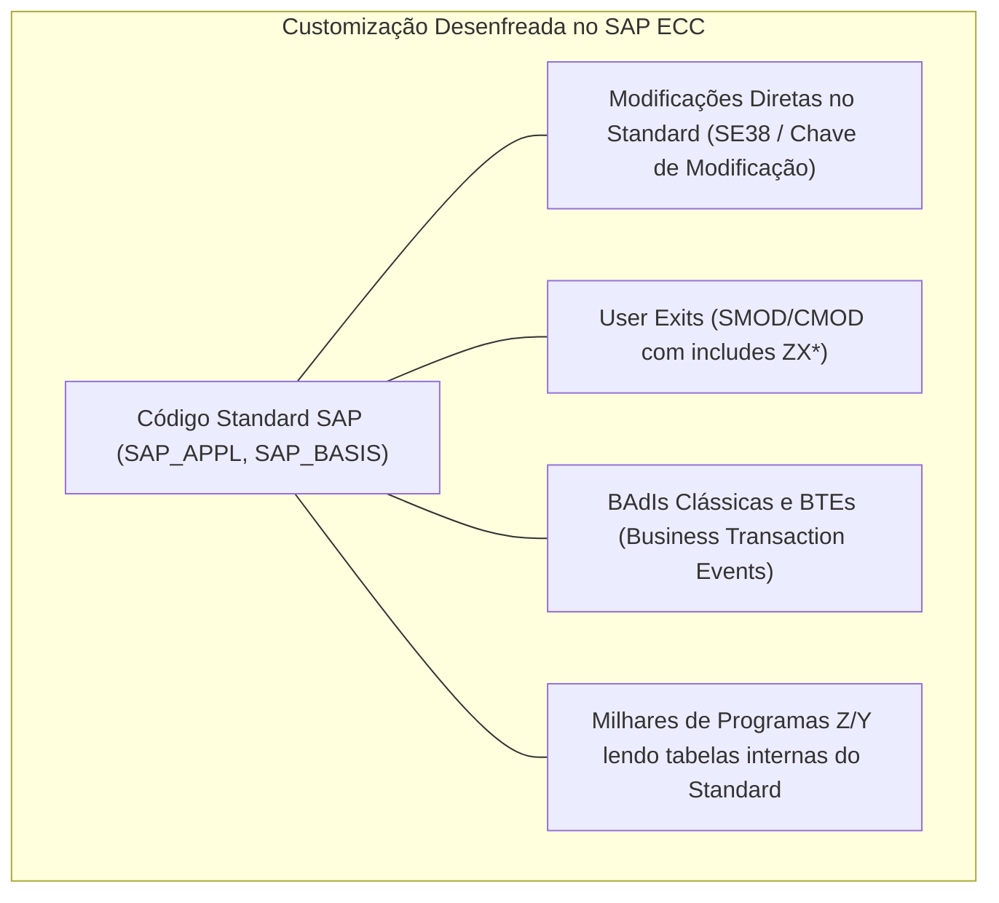
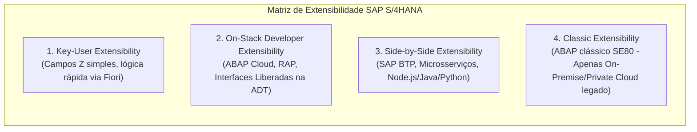

# SAP BTP e a Estratégia de Clean Core: Modernização e Extensibilidade

## 1. Contexto no SAP ECC (Como Funcionava Antes)

No ciclo de vida tradicional do **SAP ECC 6.0 e R/3**, o ecossistema corporativo desenvolveu o hábito de modificar livremente o núcleo do sistema ERP:



### Problemas Críticos do Modelo Legado de Customização
1. **Acoplamento Extremo ("Spaghetti Code")**: Desenvolvedores ABAP criavam lógicas de negócio customizadas que dependiam de chamadas a rotinas internas privadas da SAP (`PERFORM subroutine IN PROGRAM sapl...`), leitura direta de memória compartilhada de transações (`EXPORT/IMPORT TO MEMORY ID`) ou alterações de tabelas do dicionário via chaves de modificação da SAP.
2. **O Pesadelo dos Upgrades de Versão (SPAU / SPDD)**: A cada aplicação de Support Package (SPS) ou Enhancement Package (EhP), a equipe de TI precisava executar meses de revisões exaustivas nas transações `SPDD` (ajuste de dicionário de dados) e `SPAU` (ajuste de programas repositório), além de extensos testes regressivos manuais.
3. **Impossibilidade de Inovação Contínua**: O custo, o risco e a complexidade de atualizar o ECC forçavam as empresas a congelar o sistema por 4 a 7 anos sem receber inovações, novos recursos de segurança ou adequações fiscais nativas.

---

## 2. O Que Mudou no SAP S/4HANA (Arquitetura e Conceito)

Para quebrar esse ciclo vicioso e possibilitar atualizações contínuas (especialmente nas versões de nuvem pública e privada), a SAP introduziu o paradigma **Clean Core (Núcleo Limpo)**, viabilizado pela plataforma de integração e extensão **SAP Business Technology Platform (SAP BTP)**.

```mermaid
flowchart TD
    subgraph CLEAN_CORE_PARADIGM["Arquitetura Clean Core (SAP S/4HANA)"]
        subgraph S4_CORE["Núcleo S/4HANA (Core Standard)"]
            STD_CORE["Processos Standard Intactos (Best Practices)"]
            PUBLIC_API["APIs Públicas Liberadas (OData / REST / CDS)"]
            STD_CORE --- PUBLIC_API
        end

        subgraph IN_APP["Extensibilidade In-App (No Próprio S/4HANA)"]
            KEY_USER["Key-User Extensibility (Custom Fields & Logic)"]
            ABAP_CLOUD["Developer Extensibility (ABAP Cloud / RAP / BAdIs Liberadas)"]
        end

        subgraph SIDE_BY_SIDE["Extensibilidade Side-by-Side (Fora do Core)"]
            BTP["SAP BTP (Business Technology Platform)"]
            BTP_INTEG["SAP Integration Suite (Cloud Integration, API Mgmt)"]
            BTP_DEV["SAP Build / Kyma / Cloud Foundry (Node.js, Java, Python)"]
            BTP_AI["Generative AI Hub & Serviços Inteligentes"]
            BTP --- BTP_INTEG
            BTP --- BTP_DEV
            BTP --- BTP_AI
        end

        PUBLIC_API <==|"Protocolos Padronizados (HTTPS / OData / RFC Remoto)"|==> BTP
        PUBLIC_API <--> IN_APP
    end
```

### O Que Significa Manter um "Clean Core"?
1. **Core Intacto**: Zero modificações no código fonte standard fornecido pela SAP. A transação clássica de modificação com chave é expressamente desaconselhada ou bloqueada.
2. **Uso Exclusivo de Interfaces Liberadas (*Released APIs*)**: Qualquer leitura ou escrita de dados no S/4HANA deve ocorrer via objetos marcados como *Released for Key-User* ou *Released for Cloud Development* no repositório de metadados.
3. **Desacoplamento de Extensões Complexas**: Processos que envolvem integrações com terceiros, portais de fornecedores, aplicações de celular ou inteligência artificial devem residir fora do ERP, na plataforma **SAP BTP**.

### Modelos de Extensibilidade no S/4HANA



| Nível de Extensão | Onde Executa? | Ferramentas / Tecnologias | Linguagens Suportadas | Impacto em Upgrades |
| :--- | :--- | :--- | :--- | :--- |
| **Key-User Extensibility** | Dentro do S/4HANA | App Fiori *Custom Fields*, *Custom Logic* | Expressões de script gerenciadas | **Zero**. Atualizado automaticamente pela SAP |
| **Developer Extensibility (ABAP Cloud)** | Dentro do S/4HANA | Eclipse ADT (*ABAP Development Tools*), RAP (*RESTful Application Programming Model*) | Subconjunto restrito do ABAP (*ABAP Cloud*) | **Zero**. Apenas APIs e objetos liberados permitidos |
| **Side-by-Side Extensibility** | No **SAP BTP** | SAP Business Application Studio, Cloud Foundry, Kyma (Kubernetes) | TypeScript, Node.js, Java, Python, ABAP Environment (Steampunk) | **Zero**. Totalmente desacoplado do ciclo de vida do ERP |
| **Classic Extensibility (Legado)** | Dentro do S/4HANA | Transações `SE38`, `SE80`, `CMOD` | ABAP clássico irrestrito | **Alto risco**. Requer revisão em cada upgrade |

---

## 3. Impacto Prático na Migração e Armadilhas Reais de Projetos

### O Choque Cultural do Consultor e Desenvolvedor ABAP
O consultor funcional e o desenvolvedor técnico que chegam de um ambiente ECC costumam reagir com estranhamento:
- *"Cadê a SE38/SE80?"* No modelo moderno do S/4HANA e em projetos com foco em Cloud, o desenvolvimento ABAP migra obrigatoriamente para o **Eclipse com o plugin ADT (ABAP Development Tools)**.
- *"Posso fazer um SELECT direto na tabela ACDOCA ou KNA1?"* No ABAP Cloud, acessos diretos a tabelas standard são bloqueados por verificações de sintaxe. Utilizam-se as **CDS Views liberadas** (ex: `I_JournalEntryItem`, `I_Customer`).
- *"Como crio uma tela com botões?"* Telas clássicas baseadas em *Dynpro* (Module Pool) estão obsoletas. Desenvolvem-se serviços baseados em **RAP (RESTful Application Programming Model)** que geram interfaces modernas **SAP Fiori Elements** automaticamente.

### Armadilhas Reais de Projetos (*Gotchas*)

!!! danger "Armadilha 1: O "Lift & Shift" de Código Z Obsoleto"
    Em migrações do tipo *Brownfield*, muitas empresas contratam fábricas de software apenas para eliminar erros de sintaxe pontuais do código Z no S/4HANA (ex: ajustar declaração de variáveis para novas tabelas) e jogam 15 anos de programas customizados mal estruturados para dentro do novo ambiente. Esse "legado tóxico" impede que o cliente adote novidades do Fiori e transforma os upgrades semestrais ou anuais em projetos intermináveis de correção.

!!! warning "Armadilha 2: Consumo de APIs Privadas ou Não-Liberadas"
    Criar integrações que chamam RFCs clássicas (`BAPI_*`) que não foram liberadas para a nuvem (*Unreleased APIs*) cria uma bomba-relógio. Em qualquer atualização de versão do S/4HANA, a SAP tem a prerrogativa técnica de alterar parâmetros internos ou remover funções não públicas sem aviso prévio.

!!! tip "Armadilha 3: Custo de Subscrição do SAP BTP"
    O SAP BTP opera sob modelo de consumo (ex: *Pay-As-You-Go* ou *CPEA - Cloud Platform Enterprise Agreement*). Desenhar microsserviços na BTP que realizam consultas desnecessárias de alta frequência (*polling* a cada segundo no S/4HANA) gera explosão nas faturas de consumo de API Management e largura de banda. Utilize eventos assíncronos via **SAP Event Mesh / Advanced Event Mesh**.

---

## 4. Tabela de Referências Cruzadas

### Links Internos na Wiki
- [O que é o S/4HANA e Modelos de Nuvem](o-que-e-s4hana.md)
- [SAP Fiori vs SAP GUI](../02-de-para-tecnico/fiori-vs-sap-gui.md)
- [Kit de Ferramentas Técnicas (ABAP Test Cockpit - ATC)](../03-estrategias-e-ferramentas/kit-ferramentas.md)
- [Checklist de Sobrevivência (Fit-to-Standard)](../04-casos-reais-e-licoes/checklist-sobrevivencia.md)

### Links Oficiais e Notas SAP
- **SAP Note 2932977**: *Release of ABAP Development Objects for ABAP Cloud*.
- [Guia Oficial SAP Clean Core - Visão Estratégica](https://www.sap.com/products/erp/clean-core.html)
- [SAP Business Accelerator Hub (Catálogo de APIs e CDS Views)](https://api.sap.com/)
- [ABAP RESTful Application Programming Model (RAP) Documentation](https://help.sap.com/docs/BTP/9274434243a74eb49060e10ecdf088bf/c238d694e82b4212b91895a94770fd99.html)
