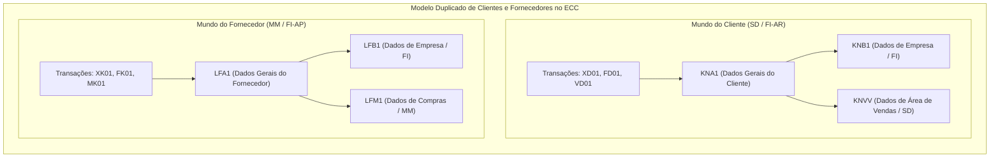
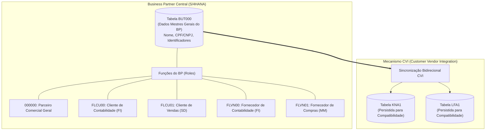
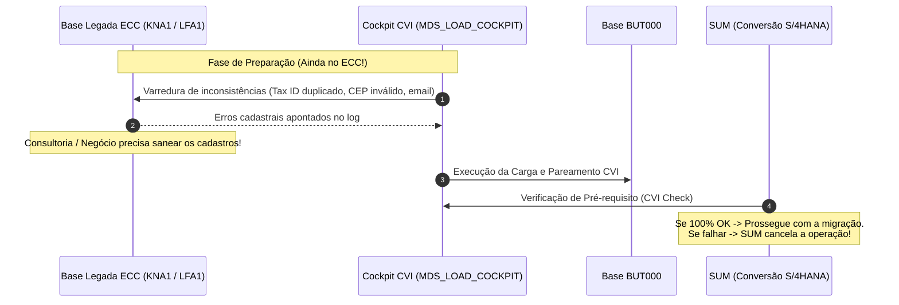

# Business Partner e CVI (Customer Vendor Integration): A Unificação de Parceiros de Negócios

## 1. Contexto no SAP ECC (Como Funcionava Antes)

No **SAP ECC 6.0**, os conceitos de **Cliente (Customer)** e **Fornecedor (Vendor)** eram tratados em silos cadastrais completamente distintos e isolados no dicionário de dados:

### Problemas Críticos do Modelo Legado
1. **Redundância Cadastral Inevitável**: Quando uma mesma entidade jurídica atuava simultaneamente como cliente e fornecedor (situação muito comum em operações de triangulação, remessa para industrialização, comodato ou grandes parceiros comerciais), ela precisava ser cadastrada **duas vezes**: uma na `XD01` e outra na `XK01`.
2. **Endereços e Dados Fiscais Desalinhados**: Alterações de razão social, endereço ou dados bancários feitas no cadastro do cliente não refletiam no cadastro do fornecedor, gerando divergências em emissões fiscais e conciliações financeiras.
3. **Múltiplos Contatos e Relacionamentos Limitados**: A gestão de múltiplos endereços de entrega ou cobrança e vínculos com colaboradores (contatos) exigia tabelas auxiliares inflexíveis (`KNVK`).

---

## 2. O Que Mudou no SAP S/4HANA (Arquitetura e Conceito)

No SAP S/4HANA, a abordagem baseada em silos foi completamente extinta. O conceito de **Business Partner (Parceiro de Negócios - BP)** tornou-se a **única entidade central de entrada e gestão de pessoas físicas, jurídicas e grupos**:

### O Que Acontece com as Transações Clássicas?
- As transações `XD01`, `XD02`, `XD03`, `XK01`, `XK02`, `XK03`, `FD01`, `FK01`, `VD01`, `MK01` **foram obsoletadas e bloqueadas**.
- Ao tentar digitar qualquer uma dessas transações no SAP GUI, o usuário é automaticamente redirecionado para a transação única **`BP`** ou deve utilizar os respectivos aplicativos SAP Fiori (*Manage Business Partners*, *Manage Customer Master*, *Manage Supplier Master*).

### Como Funciona a CVI (Customer Vendor Integration)?
Mesmo que o usuário cadastre o parceiro na transação `BP` (que grava na tabela central `BUT000`), a camada de compatibilidade do S/4HANA **precisa sincronizar os dados com as tabelas legadas `KNA1` e `LFA1`**.
Isso ocorre porque milhares de tabelas de documentos transacionais (`VBAK`, `EKKO`, `BKPF`) ainda usam os campos `KUNNR` (Código de Cliente) e `LIFNR` (Código de Fornecedor) como chaves estrangeiras. A CVI atua como um motor de espelhamento síncrono.

| Objeto de Negócio | Tabela Central S/4HANA | Tabelas de Visão Espelhada | Transação de Entrada |
| :--- | :--- | :--- | :--- |
| **Parceiro Central** | `BUT000` (Dados Gerais), `BUT020` (Endereços) | - | `BP` |
| **Função Cliente (FI/SD)** | `BUT100` (Roles `FLCU00`, `FLCU01`) | `KNA1`, `KNB1`, `KNVV` | `BP` |
| **Função Fornecedor (FI/MM)**| `BUT100` (Roles `FLVN00`, `FLVN01`) | `LFA1`, `LFB1`, `LFM1` | `BP` |
| **Dados Fiscais / CNPJ / CPF**| `DFKKBPTAXNUM` | `J_1BTAXNUM` (Localização Brasil) | `BP` (Aba Identificação) |

---

## 3. Impacto Prático na Migração e Armadilhas Reais de Projetos

### O Pesadelo do Pré-Requisito de Migração: A Sincronização CVI Obrigatória
Em qualquer projeto de conversão de sistema (*Brownfield*), **a sincronização CVI é um pré-requisito mandatório e impeditivo (Hard Stop)**. O instalador **SUM (Software Update Manager)** não permite iniciar a conversão técnica se existir um único cliente ou fornecedor no ECC que não tenha sido convertido e vinculado a um Business Partner!

### Armadilhas Reais de Projetos (*Gotchas*)

!!! danger "Armadilha 1: CVI Deixada para o Final do Projeto"
    Deixar a preparação da CVI para a reta final do cutover é o **motivo número 1 de atraso de go-live** em projetos S/4HANA. Bases de clientes com 15 anos acumulam milhares de registros com CEPs incompletos, CNPJs/CPFs inválidos ou duplicados, campos obrigatórios ausentes e bancos cadastrados incorretamente. O saneamento cadastral deve começar no primeiro dia da fase *Discover/Prepare*.

!!! danger "Armadilha 2: Configuração Incorreta de Intervalos de Numeração (Number Ranges)"
    A maior decisão de negócio em CVI é: **"O código do BP será idêntico ao código legado do cliente/fornecedor?"**
    - Se a empresa optar por *Same Numbers* (mesmo número), é necessário garantir que não haja sobreposição entre a numeração de clientes e a de fornecedores. Exemplo: se existir o cliente `1000` e o fornecedor `1000` no ECC, eles **não** podem receber o mesmo código de BP caso sejam entidades jurídicas distintas!
    - Se houver colisão de numeração, deve-se desenhar uma estratégia mista de faixas de numeração externa e interna.

!!! warning "Armadilha 3: Dados Fiscais Brasileiros (CBT / Localização Brasil)"
    No Brasil, o CNPJ/CPF e a Inscrição Estadual migram para a tabela `DFKKBPTAXNUM` com categorias de taxas específicas:
    - `BR1`: CNPJ (14 dígitos)
    - `BR2`: CPF (11 dígitos)
    - `BR3`: Inscrição Estadual
    - `BR4`: Inscrição Municipal  
    Se os dados fiscais no ECC estiverem mal formatados ou sem os dígitos verificadores válidos, o motor de validação do BP impedirá a gravação do registro durante o *MDS_LOAD_COCKPIT*.

---

## 4. Tabela de Referências Cruzadas

### Links Internos na Wiki
- [Universal Journal e a Tabela ACDOCA](universal-journal-acdoca.md)
- [Logística Simplificada e MATDOC](logistica-matdoc-sd.md)
- [Kit de Ferramentas Técnicas (SUM / Readiness Check)](../03-estrategias-e-ferramentas/kit-ferramentas.md)
- [Experiências de Clientes e Armadilhas](../04-casos-reais-e-licoes/experiencias-clientes.md)

### Links Oficiais e Notas SAP
- **SAP Note 2265093**: *S4TWL - Business Partner Approach (Customer-Vendor Integration)*.
- **SAP Note 2713963**: *CVI: Master Note for synchronization in SAP ERP to SAP S/4HANA*.
- **SAP Note 2210486**: *CVI: Guide for Customer/Vendor Integration to Business Partner in S/4HANA*.
- [SAP Community: CVI Cookbook (Guia Passo a Passo)](https://community.sap.com/topics/s4hana)
- [SAP Help Portal: Customer Vendor Integration Overview](https://help.sap.com/viewer/product/SAP_S4HANA_ON-PREMISE/)
