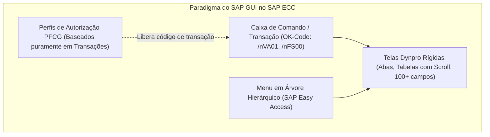
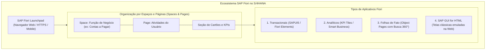

# SAP Fiori vs SAP GUI: A Nova Experiência do Usuário e De-Para de Transações

## 1. Contexto no SAP ECC (Como Funcionava Antes)

No **SAP ECC 6.0 e R/3**, a interface primária com o usuário final era quase exclusivamente o **SAP GUI (Graphical User Interface)**, um aplicativo executável nativo do Windows/Mac (`saplogon.exe`):

### Características e Limitações do SAP GUI
1. **Centrado em Transações (T-Codes)**: O usuário precisava memorizar centenas de códigos alfanuméricos misteriosos (`FBL1N`, `MB51`, `MIRO`, `XK03`, `ME23N`, `VA05`).
2. **Excesso de Complexidade Cognitiva**: Uma única tela Dynpro standard do ECC (ex: criação de ordem de venda `VA01`) exibe mais de 80 campos e dezenas de abas, dos quais a maioria dos operadores corporativos preenche apenas 5 ou 6.
3. **Incompatibilidade com Dispositivos Móveis e Web Moderna**: O SAP GUI exigia instalação local em cada computador da empresa, não era responsivo e operava mal em tablets, smartphones ou navegadores web externos.

---

## 2. O Que Mudou no SAP S/4HANA (Arquitetura e Conceito)

O S/4HANA posiciona o **SAP Fiori** como o padrão mandatória e oficial de experiência do usuário (*User Experience - UX*):

### Principais Pilares do SAP Fiori
- **Baseado em Funções de Negócio (*Role-Based*)**: O operador não vê um menu genérico com milhares de transações; ele enxerga um painel exclusivo desenhado para a sua função operacional através de perfis padrão de negócio (**Business Roles**, ex: `SAP_BR_AP_ACCOUNTANT` para Analista de Contas a Pagar).
- **Três Tipos Principais de Aplicativos Fiori**:
  1. **Transacionais**: Focados em criar, modificar e aprovar tarefas com interfaces minimalistas desenvolvidas em **SAPUI5** ou geradas via **Fiori Elements**.
  2. **Analíticos**: Gráficos dinâmicos, relatórios multidimensionais e visões de KPI baseados em CDS Views em tempo real sobre a memória do HANA.
  3. **Folhas de Fato (*Factsheets*)**: Telas de visão 360 graus que permitem navegação contextual rápida (ex: clicar no número de uma fatura para abrir a folha do cliente, seus limites de crédito e últimas ordens sem trocar de janela).
- **Fiori Apps Reference Library**: O catálogo online oficial da SAP contendo os metadados de mais de 15.000 aplicativos Fiori, indicando a correspondência exata para cada transação do ECC, componentes de software necessários e roles do PFCG.

---

## 3. Tabela De-Para Definitiva: Transações Clássicas vs S/4HANA

Abaixo apresentamos a matriz de conversão das transações mais utilizadas no dia a dia corporativo:

| Módulo | Transação Legada (ECC) | Nova Transação / App Fiori no S/4HANA | Nome do Aplicativo Fiori / Conceito | Status da Transação Clássica |
| :--- | :--- | :--- | :--- | :--- |
| **FI** | `FS00` | Fiori: `Manage G/L Account Master Data` | Administrar Dados Mestres do Razão | Ativa no GUI / Disponível no Fiori |
| **FI** | `FBL1N` | Fiori: `Manage Supplier Line Items` | Administrar Partidas de Fornecedores | Obsoleta (Substituída pelo App) |
| **FI** | `FBL3N` | Fiori: `Manage G/L Line Items` | Administrar Partidas do Razão | Obsoleta (Substituída pelo App) |
| **FI** | `FBL5N` | Fiori: `Manage Customer Line Items` | Administrar Partidas de Clientes | Obsoleta (Substituída pelo App) |
| **FI** | `F.01` | Fiori: `Balance Sheet / Income Statement` | Exibir Balanço / Demonstração de Resultados | Ativa no GUI / App Analítico Multidimensional |
| **FI/MM**| `XK01 / XK02 / XK03`| `BP` ou App `Manage Supplier Master` | Administrar Dados de Fornecedores | **Bloqueada** (Redireciona para `BP`) |
| **FI/SD**| `XD01 / XD02 / XD03`| `BP` ou App `Manage Customer Master` | Administrar Dados de Clientes | **Bloqueada** (Redireciona para `BP`) |
| **MM** | `MB01 / MB1C / MB11` | `MIGO` ou App `Post Goods Movement` | Registrar Movimento de Mercadorias | **Bloqueada** (Redireciona para `MIGO`) |
| **MM** | `MB51` | Fiori: `Material Documents Overview` | Visão Geral de Documentos de Material | Ativa no GUI / App Fiori Recomendado |
| **MM** | `ME21N / ME22N` | Fiori: `Manage Purchase Orders` | Administrar Pedidos de Compra | Ativa no GUI / App Fiori Responsivo |
| **MM** | `MIRO` | Fiori: `Create Supplier Invoice` | Criar Fatura de Fornecedor | Ativa no GUI / App Fiori com OCR |
| **SD** | `VA01 / VA02 / VA03` | Fiori: `Manage Sales Orders` | Administrar Ordens do Cliente | Ativa no GUI / App Fiori Disponível |
| **SD** | `VF01 / VF02 / VF03` | Fiori: `Create / Manage Billing Documents`| Criar / Administrar Documentos de Faturamento | Ativa no GUI / App Fiori Disponível |
| **CO** | `KA01 / KA02 / KA03` | `FS00` | Dados Mestres da Conta do Razão | **Extinta** (Incorporada na `FS00`) |
| **CO** | `KO01 / KO02 / KO03` | Fiori: `Manage Internal Orders` | Administrar Ordens Internas | Ativa no GUI / App Fiori |
| **AA** | `AS01 / AS02 / AS03` | Fiori: `Manage Fixed Assets` | Administrar Imobilizado | Ativa no GUI / App Fiori |

---

## 4. Impacto Prático na Migração e Armadilhas Reais de Projetos

### O Desafio da Resistência dos Usuários Finais ("Cadê Meu SAP GUI?")
O maior choque em projetos de migração ocorre quando os usuários de negócio se recusam a usar o navegador web e exigem continuar usando o SAP GUI tradicional:
- *"Eu sou muito mais rápido digitando /nVA01 do que clicando em blocos no Fiori!"*
- O arquiteto de projeto deve deixar claro que, no S/4HANA On-Premise e Private Cloud, **o SAP GUI continua sendo suportado para transações operacionais complexas**, mas novas funcionalidades inovadoras (como relatórios preditivos, workflows flexíveis e dashboards gerenciais) **só existem no SAP Fiori**.

### Armadilhas Reais de Projetos (*Gotchas*)

!!! danger "Armadilha 1: Explosão de Perfis de Autorização (PFCG) no Fiori"
    No ECC, conceder acesso a uma função envolvia adicionar o código da transação no objeto `S_TCODE` na transação `PFCG`. No SAP Fiori, a segurança é muito mais complexa: envolve **Catálogos de Negócios (Business Catalogs)**, **Grupos/Páginas**, **Objetos Semânticos**, **Ações (Intents)** e ativação de **Serviços OData no SAP Gateway** (transação `/IWFND/MAINT_SERVICE`). Ignorar essa nova modelagem gera milhares de tickets de autorização no primeiro dia de homologação.

!!! warning "Armadilha 2: Lentidão no Navegador e Cache de Fiori Desatualizado"
    Após atualizações de Support Packages ou transportes de melhorias no Fiori, é frequente que os usuários relatem telas brancas ou erros de script. Isso ocorre por inconsistências no cache do navegador e do servidor. É imperativo executar periodicamente os relatórios de limpeza de cache de metadados (`/UI2/INVALIDATE_GLOBAL_CACHES`, `/UI2/DELETE_CACHE`).

!!! tip "Armadilha 3: Uso Indiscriminado do SAP GUI for HTML (WebGUI)"
    Colocar atalhos no Fiori Launchpad apenas para abrir telas clássicas do SAP GUI dentro do navegador via WebGUI não entrega os benefícios de ergonomia e performance do Fiori nativo e consome recursos substanciais de memória no Application Server ABAP. Priorize sempre os aplicativos Fiori nativos baseados em SAPUI5.

---

## 5. Tabela de Referências Cruzadas

### Links Internos na Wiki
- [Universal Journal e a Tabela ACDOCA](universal-journal-acdoca.md)
- [Logística Simplificada e MATDOC](logistica-matdoc-sd.md)
- [Business Partner e CVI](business-partner-cvi.md)
- [Checklist de Sobrevivência (Fit-to-Standard)](../04-casos-reais-e-licoes/checklist-sobrevivencia.md)

### Links Oficiais e Notas SAP
- **SAP Note 2221151**: *Release Information: SAP Fiori for SAP S/4HANA*.
- **SAP Note 2434549**: *FAQ: S/4HANA Fiori Launchpad and Security*.
- [SAP Fiori Apps Reference Library (Portal Oficial de Catálogo)](https://fioriappslibrary.hana.ondemand.com/sap/fix/externalViewer/)
- [SAP Fiori Design Guidelines (Diretrizes de Interface)](https://experience.sap.com/fiori-design/)
