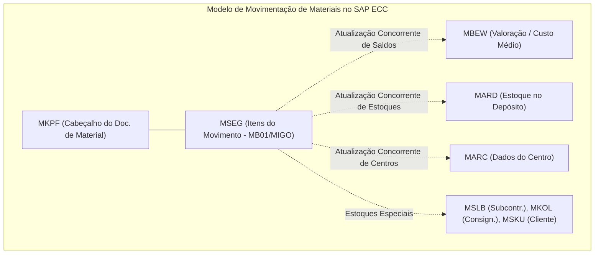
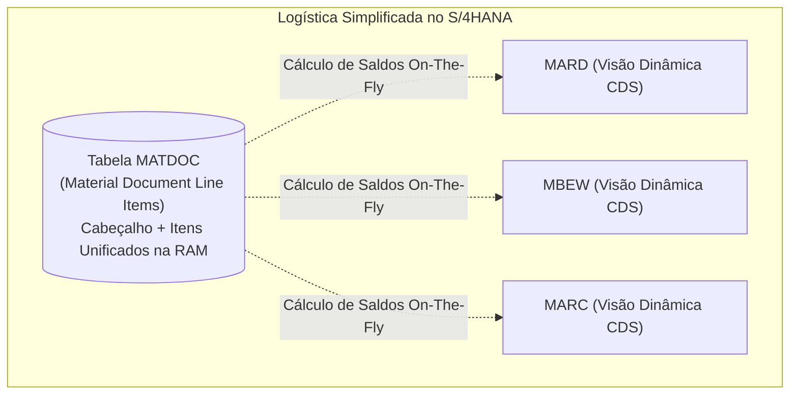
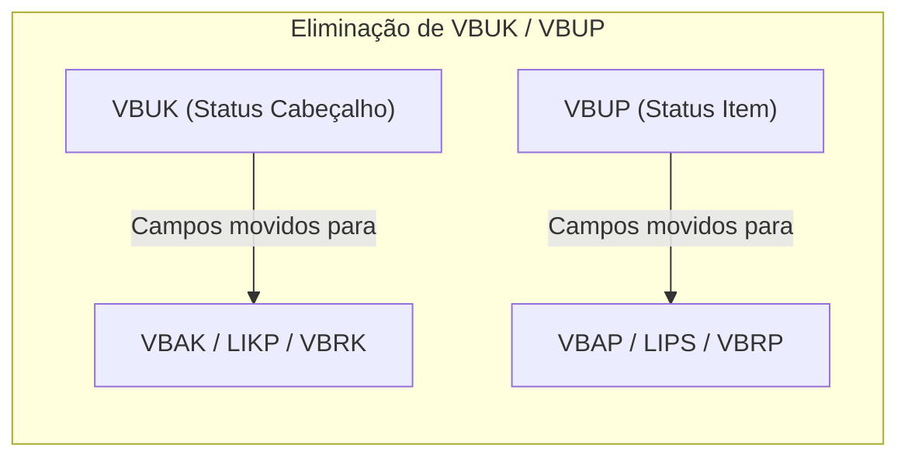

# Logística Simplificada: Tabela MATDOC e a Eliminação de VBUK/VBUP em SD

## 1. Contexto no SAP ECC (Como Funcionava Antes)

Na logística clássica do SAP ECC (módulos **MM - Gestão de Materiais** e **SD - Vendas e Distribuição**), o modelo de dados refletia a necessidade de contornar a lentidão de leitura de banco através de segregação extrema e cálculo de saldos pré-armazenados.

### Gargalos Críticos de Logística no ECC
1. **Bloqueio de Tabela e Concorrência (*Material Master Locks*)**: A cada lançamento de entrada ou saída de mercadorias (`MIGO`), o SAP ECC precisava atualizar os totais acumulados em `MARD` e `MBEW`. Para evitar inconsistências de saldo, o sistema aplicava um bloqueio exclusivo (*exclusive lock*) no registro do material no centro. Se dezenas de usuários ou leitores de código de barras tentassem movimentar o mesmo SKU simultaneamente, o sistema gerava filas de espera e erros de *Lock Time-out*.
2. **Duplicidade em Vendas e Distribuição (`VBUK` e `VBUP`)**: No módulo SD, o status de processamento de ordens de venda, remessas e faturamento não ficava na tabela principal. Criaram-se as tabelas `VBUK` (status de cabeçalho) e `VBUP` (status de item). Um relatório de vendas precisava fazer junções de alta latência entre `VBAK`, `VBAP`, `VBUK` e `VBUP`.
3. **Limite Histórico do Código do Material**: O campo `MATNR` no ECC possuía limite de **18 caracteres**, exigindo tabelas de conversão externa para códigos longos de indústrias automotivas, aeroespaciais ou químicas.

---

## 2. O Que Mudou no SAP S/4HANA (Arquitetura e Conceito)

O S/4HANA consolidou e revolucionou a arquitetura logística com a introdução da tabela **`MATDOC`** e o achatamento das tabelas de status em SD:

### Principais Inovações em MM (Gestão de Materiais)
- **Tabela MATDOC**: Unifica cabeçalho e item do movimento de mercadorias em uma única tabela colunar ultrarrápida.
- **Eliminação de Bloqueios Concorrentes**: O S/4HANA não precisa mais atualizar tabelas de agregados durante o movimento de mercadoria. A quantidade de estoque físico atual é calculada somando os deltas da `MATDOC` em tempo real. Isso elimina os clássicos problemas de bloqueio de materiais em armazéns de alta rotação.
- **Compatibility Views para MKPF e MSEG**: As transações ou relatórios que ainda executam `SELECT` em `MKPF` e `MSEG` são redirecionados automaticamente pelo banco para as CDS Views de compatibilidade (`NSDM_E_MKPF` e `NSDM_E_MSEG`).
- **Extensão do Código de Material para 40 Caracteres**: O campo de material foi estendido de 18 para **40 caracteres (`MATNR40`)**. O uso dos 40 caracteres é opcional e controlado por ativação explícita no Customizing.

### Principais Inovações em SD (Vendas e Faturamento)
- **Extinção de VBUK e VBUP**: As tabelas de status `VBUK` e `VBUP` foram descontinuadas. Todos os campos de status foram transferidos diretamente para as tabelas principais de negócio:
  - Cabeçalho de Ordem de Venda: campos incorporados diretamente na **`VBAK`**.
  - Item de Ordem de Venda: campos incorporados diretamente na **`VBAP`**.
  - Remessas (*Deliveries*): status incorporados em **`LIKP`** (cabeçalho) e **`LIPS`** (item).
  - Faturamento (*Billing*): status incorporados em **`VBRK`** (cabeçalho) e **`VBRP`** (item).
- **Substituição da Tabela de Condições de Preço KONV**: A clássica tabela `KONV` foi substituída pela tabela transparente de alta performance **`PRCD_ELEMENTS`**.

---

## 3. Impacto Prático na Migração e Armadilhas Reais de Projetos

### O Que Quebra no Código Customizado (Z) de Logística
1. **Comandos SELECT em VBUK / VBUP**: Programas legados que buscam status de faturamento ou entrega em `VBUK/VBUP` sem o devido ajuste continuam lendo através de Compatibility Views. Embora a leitura funcione, ela realiza junções custosas em tempo real. No caso de novas implementações ou refatoração, o acesso deve ser direto a `VBAK/LIKP/VBRK`.
2. **Leitura e Gravação em KONV**: Rotinas de cálculo de preços (User Exits em `MV45AFZZ` ou fórmulas VOFM) que utilizam variáveis tipadas diretamente em `KONV` falham ou não encontram dados. É mandatório adotar a estrutura **`PRCD_ELEMENTS`**.
3. **Transações Clássicas Descontinuadas**: Transações de movimentação de material legadas (`MB01`, `MB02`, `MB03`, `MB11`, `MB1A`, `MB1B`, `MB1C`) foram completamente descontinuadas no S/4HANA. Qualquer tentativa de executá-las redireciona compulsoriamente para a transação unificada **`MIGO`** ou para os apps Fiori correspondentes.

### Armadilhas Reais de Projetos (*Gotchas*)

!!! danger "Armadilha 1: Expansão do MATNR para 40 Caracteres Sem Alinhar Interfaces"
    Ativar os 40 caracteres do campo `MATNR` sem um mapeamento rigoroso de todos os sistemas satélites integrados (WMS terceiros, e-commerce, CRM, PDV, EDI com clientes e fornecedores) gerará falhas imediatas de integração por truncamento de string. Só ative os 40 caracteres se todos os sistemas do ecossistema suportarem a nova tipagem.

!!! warning "Armadilha 2: Criação de Movimentos de Material Via INSERT em MSEG"
    Softwares legados de integração que tentavam registrar entrada de notas fiscais gravando diretamente na `MSEG` para burlar validações standard causam corrupção imediata da consistência de estoque no S/4HANA. Todas as integrações devem ser migradas obrigatoriamente para a BAPI standard `BAPI_GOODSMVT_CREATE` ou para o serviço OData `API_MATERIAL_DOCUMENT`.

!!! tip "Armadilha 3: Relatórios Z de Posição de Estoque Lentos"
    Programas Z antigos que varriam a tabela `MARD` e `MBEW` linha por linha para emitir balancetes de estoque físico agora leem uma *View* calculada sobre a `MATDOC`. Em bases com 50 milhões de movimentações, o tempo de execução pode subir se os filtros de seleção não incluírem o Centro (`WERKS`) e o Depósito (`LGORT`). Utilize as novas CDS Views analíticas standard da SAP (`I_MaterialStock`).

---

## 4. Tabela de Referências Cruzadas

### Links Internos na Wiki
- [Universal Journal e a Tabela ACDOCA](universal-journal-acdoca.md)
- [Business Partner e Conversão CVI](business-partner-cvi.md)
- [SAP Fiori vs SAP GUI](fiori-vs-sap-gui.md)
- [Kit de Ferramentas Técnicas (ATC e Simplification Check)](../03-estrategias-e-ferramentas/kit-ferramentas.md)

### Links Oficiais e Notas SAP
- **SAP Note 2206980**: *Material Inventory Management: Change of Data Model in SAP S/4HANA*.
- **SAP Note 2267306**: *S4TWL - SD Simplified Data Model*.
- **SAP Note 2267140**: *S4TWL - SD Pricing Data Model (PRCD_ELEMENTS)*.
- **SAP Note 2232396**: *S4TWL - Extension of Material Number Length to 40 characters*.
- [SAP Simplification Item Catalog: Inventory Management Simplification](https://launchpad.support.sap.com/#/sic/)
