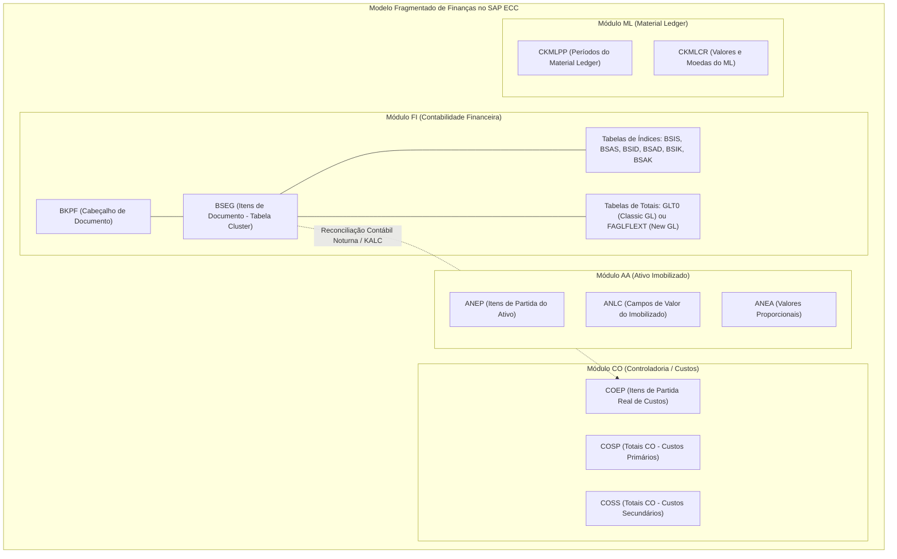
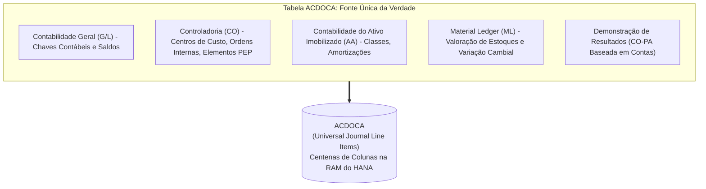
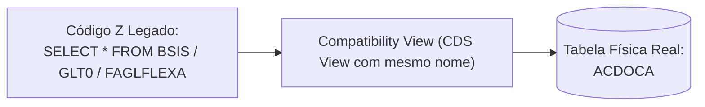
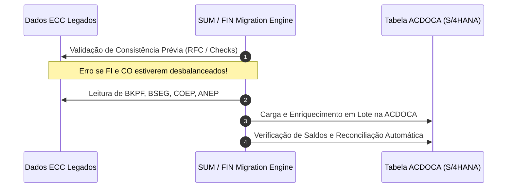

# Universal Journal e a Tabela ACDOCA: A Revolução em Finanças e Controladoria

## 1. Contexto no SAP ECC (Como Funcionava Antes)

No **SAP ECC 6.0**, os módulos de Finanças (**FI**) e Controladoria (**CO**) foram historicamente desenvolvidos como aplicações separadas com bancos de dados e lógicas contábeis desacopladas:



### Principais Dores e Desafios no ECC
1. **Divergências Crônicas entre FI e CO**: No ECC, um lançamento de custos com centro de custo secundário era registrado exclusivamente em `COEP/COSS`. Se houvesse transferência entre centros de custo que pertenciam a divisões ou áreas de negócio distintas, o balanço de FI ficava desbalanceado até que o processo batch de reconciliação de tempo real (*Real-Time Integration FI-CO*) ou a transação `KALC` fosse executada.
2. **Multiplicidade de "Fontes da Verdade"**: Um mesmo fato contábil gerava registros em `BSEG` (FI), `COEP` (CO), `ANEP` (Ativo Fixo) e `CKMLCR` (Material Ledger). Relatórios executivos exigiam junções complexas de SQL (*Joins*) entre módulos distintos para tentar conciliar valores.
3. **Lentidão Extrema no Fechamento Contábil de Fim de Mês**: A apuração do balanço dependia de cálculos intermediários demorados, travamento de tabelas e atualização massiva de índices e saldos acumulados.

---

## 2. O Que Mudou no SAP S/4HANA (Arquitetura e Conceito)

O S/4HANA eliminou completamente a fragmentação financeira ao introduzir o conceito de **Universal Journal (Diário Universal)**, materializado na gigantesca tabela transparente **`ACDOCA`**.



### Anatomia da Tabela ACDOCA
- **Tabela Transparente Colunar**: Criada diretamente no SAP HANA, com mais de 350 colunas.
- **Nenhum Agregado Pré-Calculado**: Saldos de contas do Razão, centros de custo ou clientes não são mais lidos de tabelas de totais. O HANA calcula saldos em milissegundos somando diretamente os lançamentos da `ACDOCA` com funções agregadoras `SUM()`.
- **Relação entre `BKPF`, `BSEG` e `ACDOCA`**:
  - `BKPF` (Cabeçalho): Continua existindo como tabela central de cabeçalho do documento contábil financeiro.
  - `BSEG` (Itens de Entrada): Continua sendo gravada para processos que exigem controle de partidas em aberto (*Open Item Management*), como contas a pagar (fornecedores) e contas a receber (clientes), ou lançamentos manuais. Porém, para fins de balanço, DRE e relatórios gerenciais, **a leitura padrão é direcionada para a `ACDOCA`**.
  - `ACDOCA` (Universal Journal): Contém **todas** as linhas de FI, CO, AA e ML com rastreabilidade total do número do documento original.

### O Que São as Compatibility Views?
Para evitar que milhares de programas Z legados deixassem de funcionar abruptamente, a SAP implementou o mecanismo de **Compatibility Views (Visões de Compatibilidade / Redirecionamento)**:



As tabelas de índices e agregados do ECC (`BSIS`, `BSAS`, `BSID`, `BSAD`, `BSIK`, `BSAK`, `GLT0`, `FAGLFLEXA`, `FAGLFLEXT`, `KNC1`, `LFC1`, `COSP`, `COSS`) **deixaram de existir como tabelas físicas de banco de dados**. Elas foram substituídas no Dicionário ABAP (SE11) por *Views* de banco que leem dinamicamente da tabela `ACDOCA`.

---

## 3. Impacto Prático na Migração e Armadilhas Reais de Projetos

### O Grande Desafio do Cutover: Conversão de Dados Financeiros
Durante a conversão do sistema (*System Conversion* via SUM), o processo mais crítico e demorado do projeto é a **Migração Financeira (FIN Migration)**:
1. O instalador unifica os dados históricos dispersos em `BKPF`, `BSEG`, `COEP`, `ANEP` e `CKMLCR`.
2. Cria os novos registros consolidados na tabela `ACDOCA`.
3. Executa centenas de verificações de consistência contábil.



### Armadilhas Reais de Projetos (*Gotchas*)

!!! danger "Armadilha 1: Inconsistências Históricas entre FI e CO Bloqueiam o SUM"
    Se no seu ECC legado houver lançamentos de custos em `COEP` que não possuem documento contábil correspondente em `BKPF/BSEG` (muito comum em sistemas com mais de 10 anos de operação sem reconciliação rigorosa), **a migração financeira falhará com erro fatal durante o cutover**.  
    *Ação Obrigatória*: Executar os relatórios preparatórios de consistência financeira da SAP (ex: `FINS_MIG_PRECHECK`) meses antes do go-live oficial e sanear os saldos.

!!! danger "Armadilha 2: Comandos `INSERT`, `UPDATE` ou `MODIFY` em Tabelas Eliminadas"
    As *Compatibility Views* funcionam **apenas para leitura (`SELECT`)**. Se um programa Z legado tentar realizar operações de gravação direta:
    ```abap
    " ESTE COMANDO QUEBRA NO S/4HANA COM DUMP SQL!
    INSERT INTO bsis VALUES ls_bsis.
    UPDATE knc1 SET um01s = um01s + 100 WHERE ...
    ```
    O sistema gerará um dump em tempo de execução (`CX_SY_OPEN_SQL_DB`), pois não é possível inserir linhas em uma *View* sem persistência própria. Todas as gravações contábeis devem usar as BAPIs oficiais (ex: `BAPI_ACC_DOCUMENT_POST`) ou APIs do S/4HANA.

!!! warning "Armadilha 3: Elementos de Custo Primários e Secundários Viraram Contas do Razão"
    No ECC, contas contábeis de resultado (FS00) e classes de custo (KA01/KA06) eram cadastradas separadamente. No S/4HANA, a transação `KA01` foi extinta. As classes de custo foram absorvidas diretamente pelo cadastro da conta contábil na transação **`FS00`** (novo campo: *G/L Account Type*). Todas as classes de custo secundárias passam a exigir uma conta contábil no plano de contas.

---

## 4. Tabela de Referências Cruzadas

### Links Internos na Wiki
- [O que é o S/4HANA e Modelos de Nuvem](../01-fundamentos/o-que-e-s4hana.md)
- [Arquitetura SAP HANA (In-Memory & Colunar)](../01-fundamentos/arquitetura-hana.md)
- [Kit de Ferramentas Técnicas (SUM / DMO e Readiness Check)](../03-estrategias-e-ferramentas/kit-ferramentas.md)
- [Checklist de Sobrevivência (Fit-to-Standard)](../04-casos-reais-e-licoes/checklist-sobrevivencia.md)

### Links Oficiais e Notas SAP
- **SAP Note 2270387**: *S4TWL - FIN: Data Model in S/4HANA Finance*.
- **SAP Note 2408083**: *FAQ: Data Model in S/4HANA Finance*.
- **SAP Note 2182725**: *Installation/Migration to S/4HANA Finance - Troubleshooting*.
- [SAP Help Portal: Universal Journal Architecture](https://help.sap.com/viewer/product/SAP_S4HANA_ON-PREMISE/)
- [Simplification Item Catalog: Simplification of Financial Data Model](https://launchpad.support.sap.com/#/sic/)
