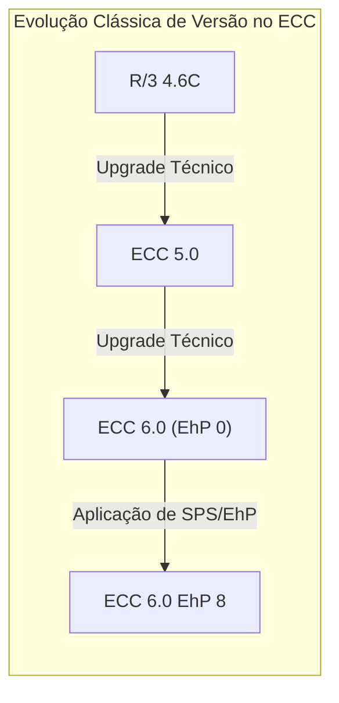
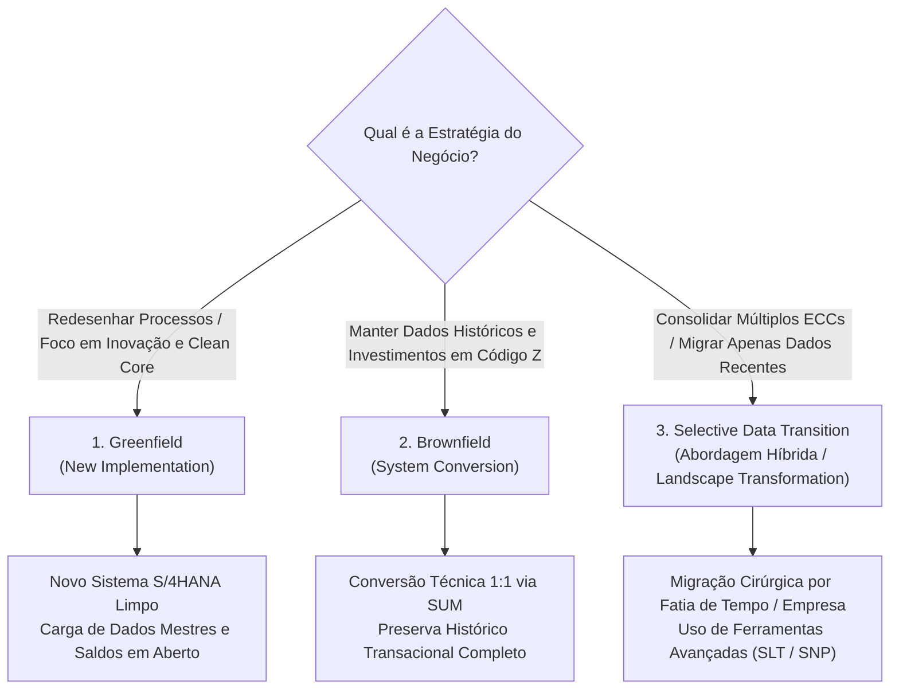
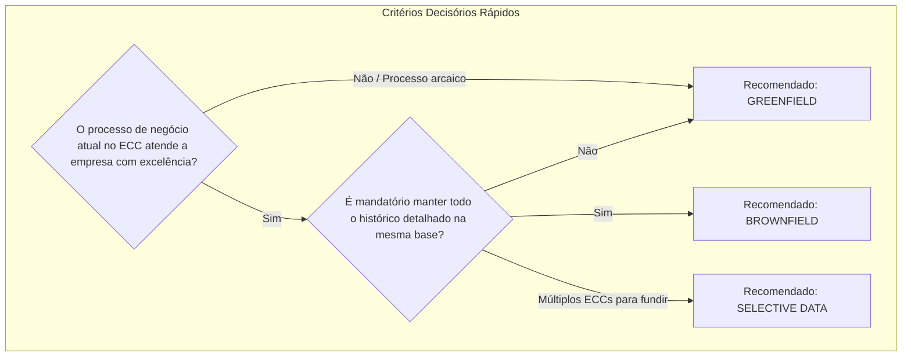

# Abordagens de Migração: Brownfield, Greenfield e Selective Data Transition

## 1. Contexto no SAP ECC (Como Funcionava Antes)

No histórico de evolução do ERP da SAP, as atualizações entre versões do R/3 e a aplicação de *Enhancement Packages* (EhP 1 a 8) no SAP ECC 6.0 seguiam uma abordagem estritamente técnica de **atualização no mesmo local (*In-Place Upgrade*)**:

### Características do Cenário Legado
- **Continuidade Indiscriminada de Dados Históricos**: Toda a base de dados (incluindo documentos contábeis e de materiais de 15 a 20 anos atrás) era preservada automaticamente na mesma instância.
- **Acúmulo de Código Customizado Obsoleto ("Dívida Técnica")**: Milhares de desenvolvimentos Z criados para suprir carências que o SAP R/3 tinha no ano 2000 continuaram ativos no ECC, mesmo após a SAP ter lançado soluções standard para os mesmos problemas.
- **Estruturas Organizacionais Rígidas**: Modificar planos de contas, estruturas de centro de custo ou fusões de empresas exigia projetos custosos e arriscados de transformação de dados (*SAP Landscape Transformation*).

---

## 2. O Que Mudou no SAP S/4HANA (Arquitetura e Conceito)

A migração para o S/4HANA exige uma decisão estratégica fundamental de arquitetura de transição. A SAP define oficialmente **três caminhos canônicos de migração**:

### 1. Greenfield (Nova Implementação / Reimplementação)
- **Conceito**: Cria-se um ambiente S/4HANA completamente novo e limpo, adotando as melhores práticas nativas (**SAP Best Practices**).
- **Tratamento de Dados**: Não há migração de documentos transacionais históricos fechados. Migram-se apenas **dados mestres saneados** (Business Partners, Materiais, Ativos) e **saldos/partidas em aberto** (pedidos pendentes, faturas abertas, saldos de balanço).
- **Código Z**: O código legado do ECC é descartado por padrão. Apenas lógicas de real diferencial competitivo são redesenhadas sob o paradigma de **Clean Core** no SAP BTP ou ABAP Cloud.

### 2. Brownfield (Conversão de Sistema / System Conversion)
- **Conceito**: A instância existente do SAP ECC é convertida tecnicamente para SAP S/4HANA em uma única operação automatizada conduzida pela ferramenta **Software Update Manager (SUM) com DMO**.
- **Tratamento de Dados**: **100% dos dados históricos transacionais são preservados** e convertidos para os novos modelos (ex: dados de FI viram registros na `ACDOCA`; movimentos em `MSEG` viram `MATDOC`).
- **Código Z**: Todo o código customizado existente é transportado para o S/4HANA e precisa ser saneado com o apoio do **ABAP Test Cockpit (ATC)** para eliminar incompatibilidades.

### 3. Selective Data Transition (Transição Seletiva / Híbrida / "Bluefield")
- **Conceito**: Combina a flexibilidade do Greenfield com a preservação de dados do Brownfield. Permite fatiar a migração por horizonte de tempo (ex: migrar apenas os últimos 2 anos de lançamentos) ou consolidar cinco instâncias regionais legadas do ECC em um único S/4HANA corporativo.
- **Ferramentas**: Utiliza plataformas especializadas como **SAP Landscape Transformation (SLT)** ou softwares de automação de terceiros certificados pela SAP (como *SNP CrystalBridge* ou *cbs ET Enterprise Transformer*).

---

## 3. Matriz Comparativa Definitiva entre as Abordagens

| Critério de Decisão | Greenfield (Nova Implementação) | Brownfield (Conversão de Sistema) | Selective Data Transition (Híbrido) |
| :--- | :--- | :--- | :--- |
| **Aderência ao Standard** | Máxima (Adoção direta de Best Practices) | Baixa a Média (Herança de processos do ECC) | Alta (Processos redesenhados e saneados) |
| **Histórico Transacional** | Não migrado (Consultado em arquivo/legado) | **100% Preservado** no S/4HANA (`ACDOCA`) | **Parcial** (Fatia selecionada, ex: 2 anos) |
| **Impacto no Código Z** | Redução drástica (Até 90% descartado) | Manutenção da base Z (Adaptação obrigatória) | Seleção cirúrgica de programas essenciais |
| **Tempo de Downtime de Go-Live** | Curto (Carga de saldos e dados mestres) | **Longo** (Conversão de dados pesada no SUM) | Otimizado via ferramentas de migração *Near-Zero* |
| **Disrupção para o Negócio** | Alta (Gestão de Mudança e novos processos) | Baixa a Média (Usuários operam familiarmente) | Média |
| **Adequação para Cloud Pública (GROW)**| **Única opção viável** | Incompatível com Public Cloud puro | Incompatível com Public Cloud puro |
| **Complexidade e Custo** | Alto esforço de negócio / Custo inicial médio | Médio esforço de negócio / Alto esforço técnico | Alto custo de licenciamento e consultoria |

---

## 4. Impacto Prático na Migração e Armadilhas Reais de Projetos

### O Debate Estratégico: "Qual Caminho Escolher?"
A escolha entre Brownfield e Greenfield frequentemente divide a diretoria de TI e as áreas de negócio:
- A equipe de TI e finanças costuma preferir **Brownfield** pelo medo de perder histórico fiscal e pelo desejo de um projeto de menor disrupção imediata.
- A diretoria de inovação e operações prefere **Greenfield** para se livrar de processos arcaicos configurados há 20 anos.

### Armadilhas Reais de Projetos (*Gotchas*)

!!! danger "Armadilha 1: Subestimar a Janela de Downtime no Brownfield"
    Em bases de dados volumosas (acima de 5 TB), a fase de conversão de dados do SUM (criação de registros na `ACDOCA` e conferência de CVI) pode ultrapassar **60 ou 80 horas de execução ininterrupta**. Se a sua operação fabril, varejista ou de faturamento não pode parar durante um final de semana prolongado, o Brownfield tradicional se torna inviável sem técnicas avançadas de minimização de downtime (**SUM nZDM - Near-Zero Downtime Technology**).

!!! warning "Armadilha 2: O Mito do "Brownfield é Mais Barato e Rápido""
    Vender o Brownfield como um projeto simples de TI é um erro grave. Se a base de dados do ECC possuir anos de dados mestres corrompidos, saldos contábeis desbalanceados e milhares de programas Z com comandos obsoletos, o custo e o prazo de saneamento prévio no ECC podem superar os custos de um projeto Greenfield.

!!! tip "Armadilha 3: Greenfield Sem Estratégia de Arquivamento Legado"
    Ao optar por Greenfield, as áreas fiscal e jurídica frequentemente entram em pânico sobre auditorias de anos anteriores. É indispensável orçar uma solução de preservação e consulta de dados frios (*Data Retention Tool - DART* ou data lake em nuvem) para que o ECC legado possa ser desligado após o período legal de guarda de documentos.

---

## 5. Tabela de Referências Cruzadas

### Links Internos na Wiki
- [O que é o S/4HANA e Modelos de Nuvem](../01-fundamentos/o-que-e-s4hana.md)
- [Universal Journal e ACDOCA](../02-de-para-tecnico/universal-journal-acdoca.md)
- [Metodologia SAP Activate](metodologia-sap-activate.md)
- [Kit de Ferramentas Técnicas (SUM/DMO, ATC, LTMC)](kit-ferramentas.md)

### Links Oficiais e Notas SAP
- **SAP Note 2388483**: *How to decide between System Conversion and New Implementation*.
- **SAP Note 693168**: *Minimizing Downtime for Software Maintenance (nZDM)*.
- [SAP Community: Mapping Your Journey to SAP S/4HANA - A Practical Guide](https://community.sap.com/topics/s4hana)
- [SAP Standard: Selective Data Transition Engagement](https://www.sap.com/services/implementation/selective-data-transition.html)
