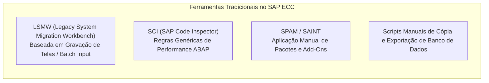
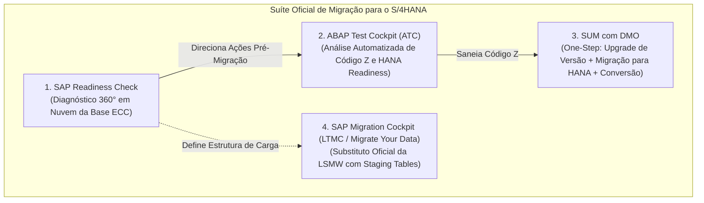
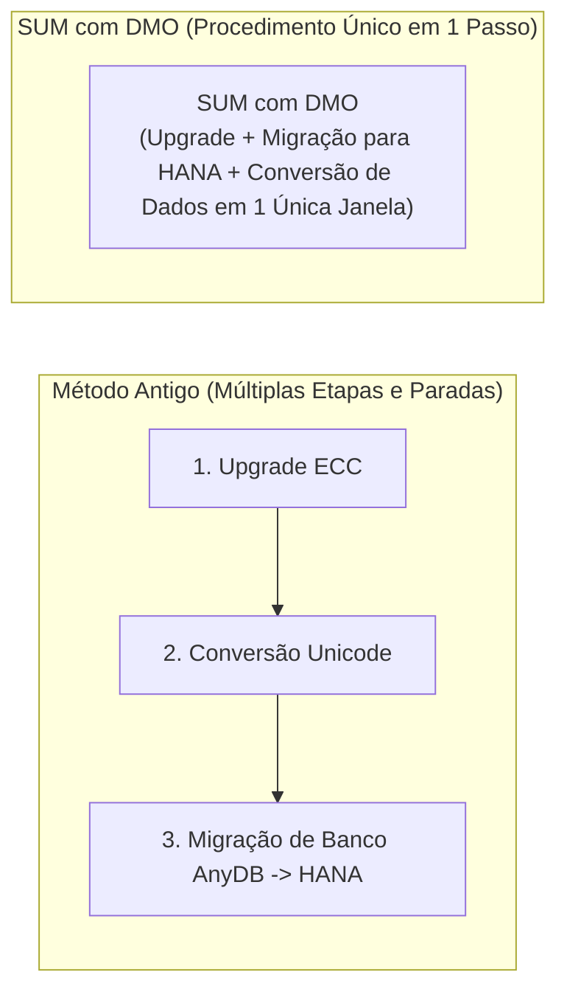
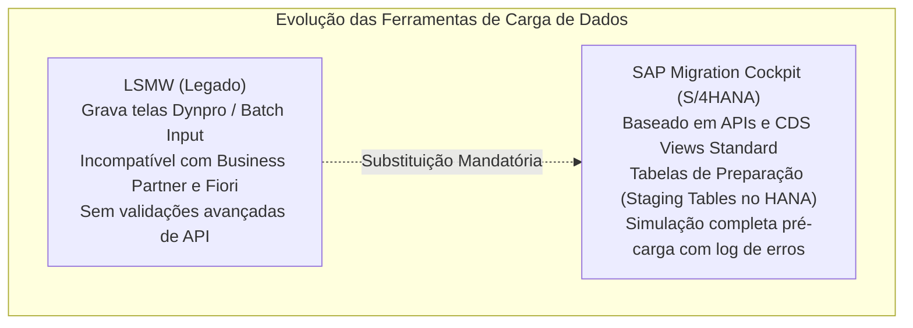

# Kit de Ferramentas Técnicas: Readiness Check, Migration Cockpit, ATC e SUM/DMO

## 1. Contexto no SAP ECC (Como Funcionava Antes)

No ambiente clássico do SAP ECC 6.0, as rotinas de carga de dados, verificação de código e migração eram compostas por um conjunto heterogêneo e muitas vezes arcaico de utilitários:



### Limitações Críticas do Ferramental Legado
1. **A Fragilidade da LSMW**: A ferramenta **LSMW** foi concebida para o SAP R/3 nos anos 90, funcionando primariamente através de gravação de telas (*Batch Input / Dynpro recording*). Quando uma tela muda um único campo ou vira uma interface web/Fiori, a gravação da LSMW quebra imediatamente.
2. **Falta de Diagnóstico Integrado de Pré-Migração**: Para planejar um upgrade, consultores experientes precisavam rodar dezenas de transações manuais e cruzar notas técnicas em planilhas Excel para descobrir quais funções deixariam de existir.
3. **Migrações em Múltiplas Etapas Lentas**: Para levar um ECC em Oracle para um banco moderno, a equipe precisava primeiro fazer o upgrade do SAP NetWeaver, depois migrar o banco de dados via exportação/importação heterogênea (*Heterogeneous System Copy*) e, em seguida, converter para Unicode, exigindo finais de semana seguidos de parada de fábrica.

---

## 2. O Que Mudou no SAP S/4HANA (Arquitetura e Conceito)

A SAP desenvolveu uma suíte moderna, integrada e altamente automatizada de ferramentas que cobrem todas as fases da transição técnica:



---

### 1. SAP Readiness Check
É o relatório de diagnóstico mais importante da fase *Discover/Prepare*. Executado dentro do ECC produtivo através de notas preparatórias (gerando um arquivo compactado que é carregado no portal em nuvem da SAP), ele avalia automaticamente:
- **Simplification Items**: Lista exata de itens de simplificação aplicáveis ao ambiente e seu nível de criticidade.
- **HANA Sizing**: Estimativa precisa da memória RAM necessária no servidor HANA, considerando descompactação e expurgo.
- **Compatibilidade de Add-Ons de Terceiros**: Checagem de softwares fiscais, mensageria e componentes de parceiros certificados.
- **Adequação do Código Z**: Volume de código customizado afetado pelas novas regras de banco.
- **Recomendação de Apps Fiori**: Mapeamento dos aplicativos Fiori ideais com base nas transações reais executadas na base legada nos últimos 12 meses.

---

### 2. ABAP Test Cockpit (ATC)
Substituto moderno do Code Inspector, configurado com variantes específicas de migração (**S4H_READINESS**). O ATC pode ser executado de forma remota (*Remote ATC*) a partir de um servidor central moderno, analisando a base ECC e identificando:
- Comandos SQL que dependem de ordenação implícita (falta de `ORDER BY`).
- Acessos a tabelas de agregados eliminadas (`SELECT FROM bsis`).
- Chamadas a funções obsoletas ou não liberadas.
- Uso de recursos de banco específicos de outros fabricantes (Oracle Hints: `/*+ INDEX(...) */`).

---

### 3. Software Update Manager (SUM) com Database Migration Option (DMO)
O **SUM com DMO** é o ápice da engenharia de conversão de sistema (*Brownfield*). Em um único procedimento (*One-Step Migration*), ele executa simultaneamente:
1. **Upgrade de Aplicação**: Converte o repositório do SAP ECC para o SAP S/4HANA.
2. **Migração de Banco de Dados**: Transfere todos os dados do banco legado (*AnyDB: Oracle/SQL Server*) diretamente para o banco in-memory **SAP HANA**.
3. **Conversão de Dados**: Transforma os registros legados nas novas tabelas (`ACDOCA`, `MATDOC`, etc.) durante a janela de downtime técnico.



---

### 4. SAP Migration Cockpit vs LSMW

A clássica ferramenta **LSMW foi formalmente descontinuada para uso no S/4HANA** (restrita apenas a objetos muito específicos e sem suporte oficial para criação de novos dados). O seu substituto canônico é o **SAP Migration Cockpit** (executado pela transação `LTMC` ou, nas versões mais recentes, pelo app Fiori **`Migrate Your Data`**).



| Critério de Comparação | LSMW (Legado ECC) | SAP Migration Cockpit (S/4HANA) |
| :--- | :--- | :--- |
| **Tecnologia de Gravação** | Gravação de telas (*Batch Input*), BAPIs legadas | **APIs oficiais, BAPIs modernas e Web Services** |
| **Compatibilidade com BP** | **Não suporta** a transação `BP` adequadamente | **Totalmente nativo** para criação e extensão de BP |
| **Ambiente de Trabalho** | Interface arcaica no SAP GUI (14 passos) | **Interface Web moderna (Fiori)** ou Staging DB |
| **Validação Prévia** | Risco de erro apenas na execução do batch | **Fase de Simulação formal** antes do commit final |
| **Armazenamento Intermediário**| Arquivos texto (.txt/.csv) locais no desktop | **Staging Tables dedicadas** na memória do SAP HANA |
| **Suporte Oficial da SAP** | Não suportada para S/4HANA | **Ferramenta oficial e mandatória** da SAP |

---

## 3. Impacto Prático na Migração e Armadilhas Reais de Projetos

### O Choque com o Descarte da LSMW
Quase todos os consultores funcionais seniores de ECC possuem dezenas de projetos LSMW salvos em arquivos `.txt` em seus computadores e tentam utilizá-los no S/4HANA:
- *"Vou criar os clientes do S/4HANA com a minha LSMW gravando a XD01!"*
- Essa tentativa **falha imediatamente**, pois a transação `XD01` é redirecionada para a `BP` e a LSMW não consegue processar os controles de abas dinâmicas do Business Partner. O consultor precisa se capacitar no **Migration Cockpit**.

### Armadilhas Reais de Projetos (*Gotchas*)

!!! danger "Armadilha 1: Add-Ons Não Certificados Bloqueiam o Início do SUM"
    Se a empresa utilizar componentes de software de terceiros (ex: mensagerias fiscais, soluções de frete ou softwares de assinatura digital instalados na transação `SAINT`) cujos fornecedores não tenham emitido um certificado de compatibilidade e pacote de upgrade para a versão alvo do S/4HANA, **o instalador SUM aborta a migração na fase inicial**. Exija as cartas de compatibilidade de todos os parceiros de software 6 meses antes da conversão.

!!! danger "Armadilha 2: SQL Dinâmico Não Detectado pelo ATC"
    O ABAP Test Cockpit é brilhante para detectar comandos estáticos como `SELECT * FROM bsis`. No entanto, se o seu sistema possuir código Z com SQL dinâmico:
    ```abap
    DATA lv_tabela TYPE tabname VALUE 'BSIS'.
    SELECT * FROM (lv_tabela) INTO TABLE ... " O ATC pode não apontar erro estático!
    ```
    O ATC pode classificar o trecho com severidade baixa, mas em produção o programa quebrará ao tentar executar operações não suportadas pela view. Realize revisões manuais em buscas por comandos dinâmicos.

!!! tip "Armadilha 3: Estouro do Sistema de Arquivos durante a Extração do SUM/DMO"
    A ferramenta SUM com DMO extrai o banco de dados inteiro do Oracle para arquivos intermediários em disco (*Pipes / R3load*) antes de enviar para o HANA. Se a área de diretório `/usr/sap/trans` ou o sistema de arquivos onde o SUM está rodando não possuir no mínimo 1.5x a 2x o tamanho total da base compactada, o processo paralisa por falta de espaço em disco no meio do cutover.

---

## 4. Tabela de Referências Cruzadas

### Links Internos na Wiki
- [Abordagens de Migração: Brownfield vs Greenfield](abordagens-migracao.md)
- [Metodologia SAP Activate](metodologia-sap-activate.md)
- [Universal Journal e ACDOCA](../02-de-para-tecnico/universal-journal-acdoca.md)
- [Business Partner e CVI](../02-de-para-tecnico/business-partner-cvi.md)

### Links Oficiais e Notas SAP
- **SAP Note 2758146**: *SAP Readiness Check for SAP S/4HANA - Central Note*.
- **SAP Note 2287723**: *LSMW in SAP S/4HANA on-premise edition*.
- **SAP Note 2537750**: *SAP S/4HANA Migration Cockpit (LTMC) - Composite Note*.
- **SAP Note 2364916**: *DMO: Tips & Tricks for SAP HANA Migration*.
- [SAP Help Portal: SAP S/4HANA Migration Cockpit Guide](https://help.sap.com/viewer/product/SAP_S4HANA_ON-PREMISE/)
