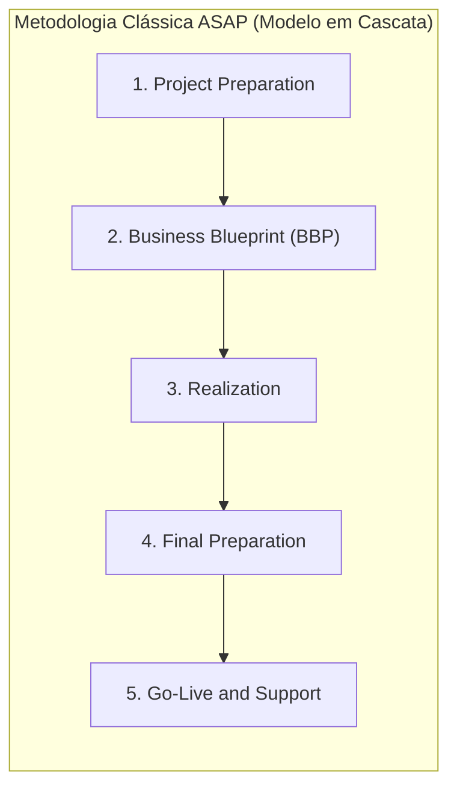
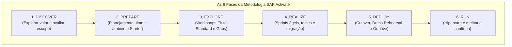
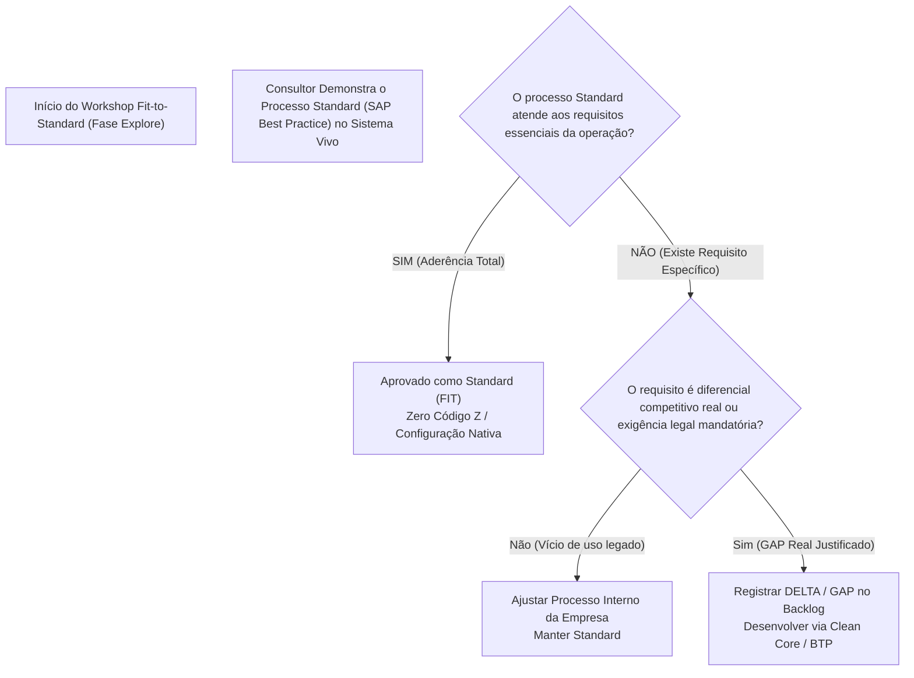
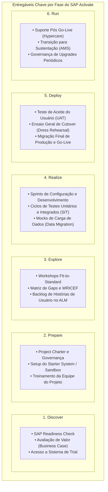

# Metodologia SAP Activate: Fases, Governança e Transição do ASAP

## 1. Contexto no SAP ECC (Como Funcionava Antes)

Durante décadas, a implementação de sistemas SAP R/3 e SAP ECC 6.0 foi guiada pela metodologia clássica **ASAP (Accelerated SAP)**, baseada no modelo linear tradicional de desenvolvimento em cascata (*Waterfall*):

### O Desafio Histórico do Business Blueprint (BBP) no ASAP
1. **O Mito da "Folha em Branco"**: Na fase de *Business Blueprint*, a consultoria se reunia com os usuários-chave (*Key Users*) e fazia a clássica pergunta: *"Como a sua empresa deseja operar este processo?"*. O cliente descrevia seus processos legados manuais, e a consultoria passava de 4 a 6 meses redigindo extensos documentos de especificação de centenas de páginas (Word/PDF).
2. **Ciclos de Aprovação Intermináveis**: Meses eram consumidos revisando e assinando termos de aceite de documentos conceituais sem que o usuário final tivesse visto uma única tela real do SAP funcionando.
3. **Explosão Descontrolada de Desenvolvimentos Z**: Como o cliente pedia a reprodução exata dos seus sistemas anteriores, o projeto gerava listas gigantescas de customizações (**WRICEF**: *Workflows, Reports, Interfaces, Conversions, Enhancements, Forms*), distanciando o ERP do padrão standard da SAP.
4. **Descompasso na Entrega**: Quando o sistema finalmente era configurado na fase de *Realization* (muitas vezes 12 a 18 meses após o início), as necessidades do mercado já haviam mudado e o sistema entregue já nascia obsoleto.

---

## 2. O Que Mudou no SAP S/4HANA (Arquitetura e Conceito)

A SAP descontinuou a metodologia ASAP e estabeleceu o **SAP Activate** como o framework oficial de implementação, unindo conceitos de **metodologia ágil (Scrum/Agile)**, processos pré-configurados (**SAP Best Practices**) e ferramentas de configuração guiada.

### Os Três Pilares do SAP Activate
1. **SAP Best Practices**: Conteúdo pré-configurado pronto para uso cobrindo processos de negócios de ponta a ponta (Order-to-Cash, Procure-to-Pay, Record-to-Report). O projeto já começa com o sistema funcionando no dia 1.
2. **Metodologia Ágil e Estruturada**: Roteiros (*Roadmaps*) prescritivos divididos em 6 fases com entregáveis e portas de qualidade (*Quality Gates*).
3. **Ferramentas de Configuração e Governança**: **SAP Cloud ALM (Application Lifecycle Management)** ou **SAP Solution Manager**, SAP Central Business Configuration (CBC) e SAP Readiness Check.

### A Revolução do Fit-to-Standard (Substituindo o BBP)

A maior quebra de paradigma do SAP Activate ocorre na fase **EXPLORE**: em vez de redigir um Blueprint a partir do nada, o time executa workshops de **Fit-to-Standard**:

| Critério de Comparação | Metodologia Legada (ASAP) | Metodologia Moderna (SAP Activate) |
| :--- | :--- | :--- |
| **Abordagem de Projeto** | Cascata (*Waterfall*) sequencial | Ágil iterativa (*Agile Sprints*) |
| **Ponto de Partida** | Folha em branco / Levantamento de desejos | **Sistema vivo com SAP Best Practices pré-carregadas** |
| **Conceituação** | *Business Blueprint* em documentos Word | **Workshops de Fit-to-Standard** no sistema real |
| **Postura com Customizações** | Customização permissiva de qualquer demanda | **Adoção do Standard por padrão**; GAPs exigem justificativa |
| **Visibilidade do Usuário** | Apenas nos testes finais (após 1 ano de projeto)| **Desde a primeira semana** na fase Prepare/Explore |
| **Ambiente de Trabalho** | Sandbox montado do zero tardiamente | **Starter System / Model Company** disponível imediatamente |

---

## 3. As 6 Fases do SAP Activate Detalhadas

---

## 4. Impacto Prático na Migração e Armadilhas Reais de Projetos

### O Desafio do Comportamento dos Usuários nos Workshops
A frase mais perigosa em um projeto S/4HANA é dita pelo usuário legado: *"No meu ECC antigo eu clicava neste botão e saía este relatório, quero exatamente igual no S/4HANA"*.
Se a liderança do projeto e a consultoria não tiverem firmeza metodológica, o workshop de Fit-to-Standard degenera rapidamente para uma sessão de cópia do sistema antigo, destruindo o ROI do projeto.

### Armadilhas Reais de Projetos (*Gotchas*)

!!! danger "Armadilha 1: Conduzir Workshops Fit-to-Standard Sem Sistema Vivo"
    O erro fatal no SAP Activate é tentar conduzir o Fit-to-Standard utilizando apenas slides de PowerPoint. Os usuários de negócio precisam ver o processo operando no **SAP Fiori**, criar uma ordem de venda real e navegar pelo documento. Sem o sistema vivo demonstrado, o usuário rejeita o padrão e exige desenvolvimentos Z desnecessários.

!!! warning "Armadilha 2: Transformar a Lista de GAPs em um Novo Monstro Z"
    Cada "GAP" identificado no Fit-to-Standard que gera um desenvolvimento de software deve passar por um comitê rígido de governança de arquitetura (**Architecture Review Board - ARB**). A pergunta norteadora deve ser: *"Este processo traz vantagem competitiva tangível para a empresa no mercado?"* Se a resposta for não, o processo interno da organização deve mudar para se adaptar ao standard do S/4HANA.

!!! tip "Armadilha 3: Ignorar os Ensaios Gerais de Cutover (Dress Rehearsals)"
    Na fase *Deploy*, nunca confie que o cronograma de go-live funcionará de primeira. É mandatória a realização de no mínimo **dois ensaios gerais completos de cutover (*Mock 1 e Mock 2 / Cutover Dress Rehearsal*)** em um ambiente cópia fiel da produção (*Staging/Pre-Prod*), cronometrando minuto a minuto o tempo de carga de dados e validação de saldos contábeis.

---

## 5. Tabela de Referências Cruzadas

### Links Internos na Wiki
- [Abordagens de Migração: Brownfield vs Greenfield](abordagens-migracao.md)
- [Kit de Ferramentas Técnicas (Readiness Check, SUM, LTMC)](kit-ferramentas.md)
- [Checklist de Sobrevivência (Fit-to-Standard)](../04-casos-reais-e-licoes/checklist-sobrevivencia.md)
- [Experiências de Clientes e Armadilhas](../04-casos-reais-e-licoes/experiencias-clientes.md)

### Links Oficiais e Notas SAP
- [SAP Roadmap Viewer: Metodologias Oficiais SAP Activate](https://roadmapviewer.sap.com/)
- [SAP Best Practices Explorer (Process Navigator)](https://me.sap.com/processnavigator)
- [SAP Cloud ALM for Implementation](https://support.sap.com/en/alm/sap-cloud-alm.html)
- [SAP Community: SAP Activate Methodology](https://community.sap.com/topics/activate)
