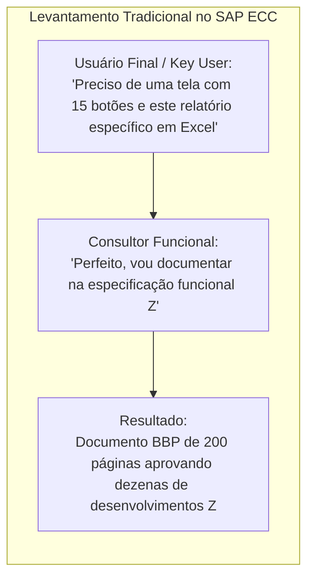
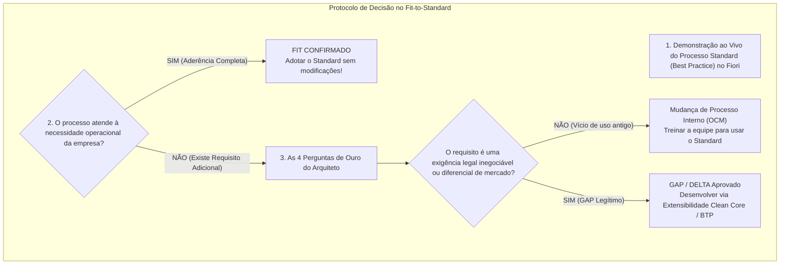

# Checklist de Sobrevivência: Guia Prático para Workshops Fit-to-Standard

## 1. Contexto no SAP ECC (Como Funcionava Antes)

Nas reuniões tradicionais de levantamento de requisitos da era SAP ECC e R/3 (conhecidas como sessões de *Business Blueprint*), a dinâmica de trabalho seguia um roteiro passivo e altamente permissivo:

### Por Que Esse Modelo Falha no S/4HANA?
1. **Destruição do Retorno sobre Investimento (ROI)**: Se a organização migrar para o S/4HANA apenas para reproduzir exatamente as mesmas telas e rotinas manuais que já usava no ECC há 20 anos, o custo milionário do projeto é desperdiçado.
2. **Incompatibilidade com o Conceito de Clean Core**: Customizações desenfreadas inviabilizam a adoção de atualizações automáticas de versão e inovação rápida.
3. **Falta de Referência Standard**: O usuário pedia customizações porque nunca havia sido apresentado às melhores práticas globais nativas do SAP.

---

## 2. O Que Mudou no SAP S/4HANA: O Novo Paradigma do Fit-to-Standard

No **SAP Activate**, o consultor funcional deixa de ser um "anotador de pedidos" para se tornar um **conselheiro de processos de negócio (*Trusted Advisor*)**. O objetivo da reunião não é perguntar o que o cliente quer, mas demonstrar a **Melhor Prática Standard (SAP Best Practice)** e desafiar qualquer desvio da norma:

---

## 3. As 4 Perguntas de Ouro para Conter Desenvolvimentos Z

Sempre que um usuário-chave ou gerente de área solicitar um programa, tela ou relatório customizado (*Z*), o consultor e o líder do projeto devem submeter a demanda às **Quatro Perguntas de Ouro**:

1. **"Existe uma exigência legal, fiscal ou regulatória mandatória que nos obriga a fazer isso?"**  
   *Se não for legal, a exigência deve ser justificada por valor de negócio.*
2. **"Este processo específico confere à nossa empresa uma vantagem competitiva real contra os nossos concorrentes de mercado?"**  
   *Processos de suporte (como emissão de pedido de compras de material de escritório ou contas a pagar padrão) não são diferenciais competitivos e devem ser 100% standard.*
3. **"Qual é a perda financeira mensurável se a empresa adotar o padrão global da SAP em vez de criar este botão?"**  
   *Se a perda for nula ou irrelevante, o processo da empresa deve mudar.*
4. **"Podemos alterar a nossa política interna em vez de alterar o código do software?"**  
   *O ERP deve moldar a empresa às melhores práticas de governança, e não a empresa moldar o ERP aos seus vícios.*

---

## 4. O Checklist Prático de Sobrevivência

Utilize este roteiro de checagem estruturado antes, durante e após cada sessão de levantamento:

### Fase A: Preparação Pré-Workshop (Antes de Entrar na Sala)
- [ ] **Ambiente Vivo Operacional**: O ambiente *Starter System* ou *Sandbox* está acessível, com os dados mestres básicos da empresa carregados?
- [ ] **Escopo Definido**: O escopo da reunião está vinculado a um código oficial de Best Practice (ex: `BD9` para *Sell from Stock*, `J45` para *Procurement of Direct Materials*)?
- [ ] **Papéis Fiori Atribuídos**: O consultor possui o usuário configurado exatamente com as *Business Roles* daquele processo no SAP Fiori?
- [ ] **Roteiro de Teste Oficial (Test Script)**: O documento com o passo a passo standard do Best Practice baixado do *SAP Process Navigator* está aberto na tela do consultor?

### Fase B: Execução Durante a Sessão (Na Frente do Cliente)
- [ ] **Demonstração Primeiro, Discussão Depois**: O processo foi executado de ponta a ponta na tela do Fiori antes de abrir a palavra para questionamentos?
- [ ] **Foco no Papel do Operador**: Ficou claro como o Fiori simplifica a vida do operador em relação ao SAP GUI antigo?
- [ ] **Combate Firme aos Falsos GAPs**: Demandas por "telas iguais ao ECC" foram educadamente redirecionadas para a experiência moderna?
- [ ] **Registro Estruturado de GAPs**: Cada desvio legítimo foi registrado contendo: *Problema de Negócio, Justificativa, Frequência de Ocorrência e Impacto Financeiro*?

### Fase C: Governança Pós-Workshop (Fechamento)
- [ ] **Classificação WRICEF / Clean Core**: O GAP foi categorizado como *In-App Key-User*, *ABAP Cloud* ou *Side-by-Side BTP*?
- [ ] **Submissão ao Architecture Review Board (ARB)**: O desenvolvimento Z proposto foi aprovado pelo arquiteto líder do projeto antes de ir para a fábrica de software?
- [ ] **Registro no SAP Cloud ALM**: A história de usuário correspondente foi cadastrada no backlog com critérios claros de aceite?

---

## 5. Tabela de Referências Cruzadas

### Links Internos na Wiki
- [SAP Fiori vs SAP GUI](../02-de-para-tecnico/fiori-vs-sap-gui.md)
- [Metodologia SAP Activate](../03-estrategias-e-ferramentas/metodologia-sap-activate.md)
- [SAP BTP e a Estratégia de Clean Core](../01-fundamentos/sap-btp-e-clean-core.md)
- [Casos Reais e Lições de Campo](experiencias-clientes.md)

### Links Oficiais e Notas SAP
- [SAP Process Navigator (Catálogo Oficial de Best Practices)](https://me.sap.com/processnavigator)
- [SAP Roadmap Viewer: Fit-to-Standard Execution Guide](https://roadmapviewer.sap.com/)
- [SAP Cloud ALM: Requisitos e Gestão de Backlog Ágil](https://support.sap.com/en/alm/sap-cloud-alm.html)
