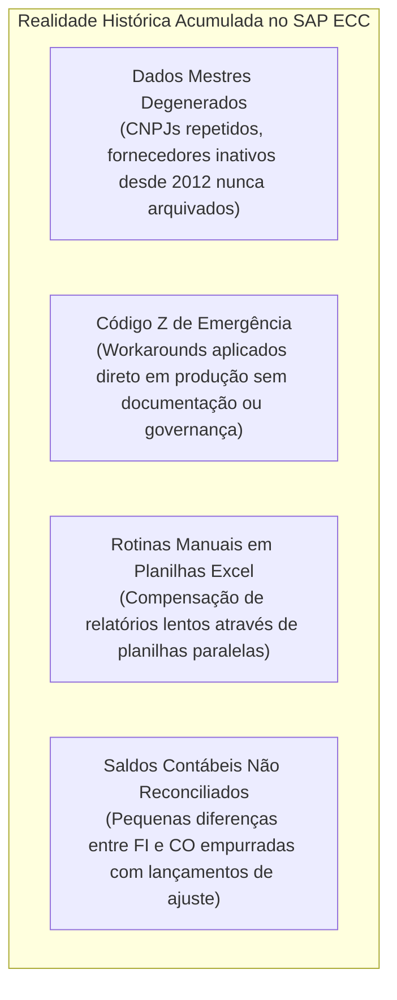
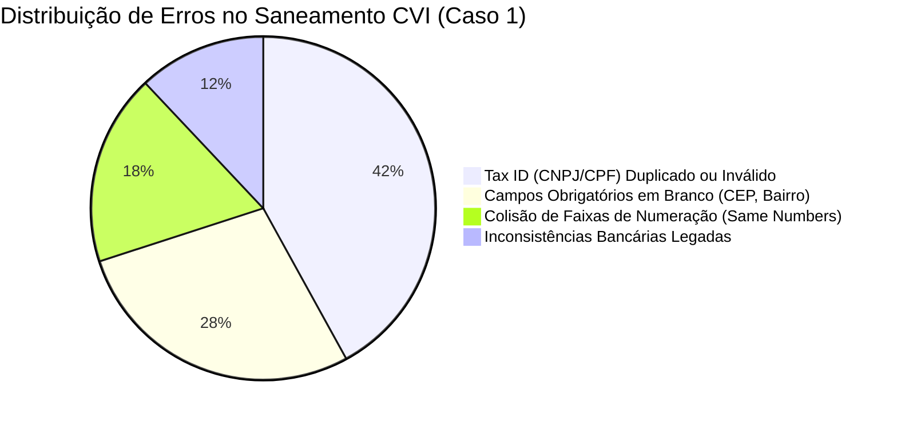
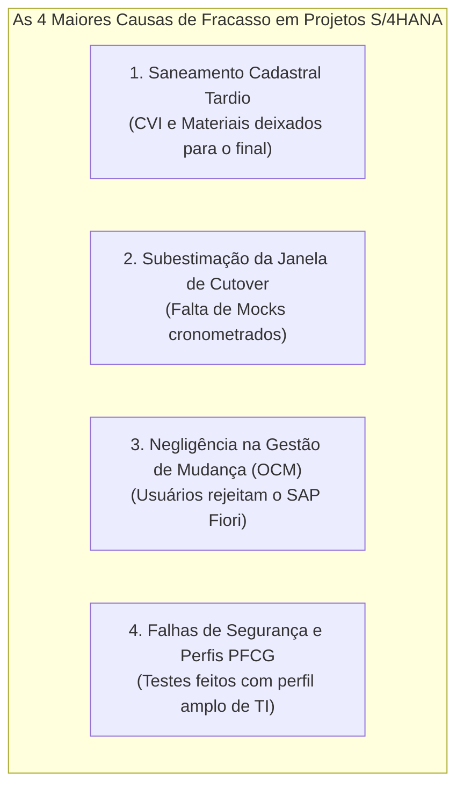

# Casos Reais de Migração: Lições de Campo, Gargalos e Armadilhas de Projetos

## 1. Contexto no SAP ECC (Como Funcionava Antes)

Durante os anos de operação contínua do SAP ECC 6.0, as organizações desenvolveram um conjunto de práticas e "vícios" operacionais que se tornaram aceitos como normais na rotina corporativa:

### O Despertar Abrupto na Migração para o S/4HANA
No ECC, o banco de dados e as transações eram tolerantes a dados incompletos ou formatos flexíveis. O SAP S/4HANA, por outro lado, opera com **validações estritas de integridade de dados na camada in-memory**. Quando a empresa decide migrar, todas as "gambiarras" e inconsistências acumuladas ao longo de uma ou duas décadas vêm à tona de uma só vez, criando choques de prazo e orçamento.

---

## 2. Relatos de Campo: Lições Reais de Grandes Projetos

Abaixo estão consolidadas três experiências práticas documentadas em projetos reais de migração no Brasil e no exterior, destacando o desafio encontrado, a causa-raiz e a solução definitiva aplicada:

### Caso 1: A Indústria Metalúrgica e o Bloqueio Fatal da Sincronização CVI
- **Cenário**: Empresa industrial com 18 anos de uso do ECC 6.0, optando por conversão *Brownfield* de uma base de 6 TB.
- **O Gargalo**: Durante a execução da transação `MDS_LOAD_COCKPIT` na preparação de CVI (Customer Vendor Integration), **mais de 45.000 clientes e fornecedores falharam na sincronização com o Business Partner**. O instalador SUM abortou a migração.
- **A Causa-Raiz**: O cadastro possuía 12.000 fornecedores com o mesmo número de CNPJ genérico (cadastros fictícios para pequenas despesas locais sem nota), milhares de registros sem preenchimento de endereço e fornecedores estrangeiros com formato postal brasileiro.
- **A Solução e Lição**: O projeto teve seu go-live adiado em 3 meses. Foi montada uma força-tarefa multidisciplinar com os times de Compras, Fiscal e Vendas para:
  1. Bloquear e marcar para exclusão cadastros inativos há mais de 3 anos (reduzindo o escopo de CVI em 60%).
  2. Implementar rotinas Z de higienização prévia de caracteres especiais.
  3. Criar a regra de que **nenhum dado mestre entra no projeto sem validação automatizada prévia**.

---

### Caso 2: A Rede de Varejo e o Pânico do Downtime no Cutover
- **Cenário**: Rede varejista com operação de e-commerce e 300 lojas físicas com faturamento ininterrupto. Janela máxima de downtime autorizada pela diretoria executiva: **36 horas (de sábado às 20h até segunda às 08h)**.
- **O Gargalo**: No primeiro simulado de cutover (*Mock 1*), a ferramenta SUM com DMO demorou **74 horas** apenas para converter a tabela de movimentos de materiais em `MATDOC` e reconciliar a `ACDOCA`.
- **A Causa-Raiz**: A tabela `MSEG` possuía 180 milhões de registros históricos desde 2008, e a equipe de TI nunca havia executado rotinas de arquivamento de dados (*Data Archiving*). Além disso, a rede de interconexão entre o servidor legado e o novo servidor HANA operava com latência elevada.
- **A Solução e Lição**:
  1. Foi executado um projeto relâmpago de **Data Archiving** que arquivou e expurgou 7 anos de movimentos antigos de materiais e faturas, reduzindo o volume do banco em 45%.
  2. Adoção da tecnologia **SUM nZDM (Near-Zero Downtime Maintenance)**, que realiza a maior parte da cópia e conversão de dados com o ECC legado ainda online para os usuários.
  3. No ensaio final (*Dress Rehearsal*), o tempo de corte caiu para **29 horas**, viabilizando o go-live seguro no final de semana planejado.

---

### Caso 3: O Conglomerado de Logística e a Explosão de Tickets no Go-Live
- **Cenário**: Migração para S/4HANA Private Cloud com implementação do SAP Fiori para 2.500 usuários.
- **O Gargalo**: No primeiro dia útil após o go-live, a central de serviços (Service Desk) recebeu mais de **1.400 chamados críticos nas primeiras 4 horas**. A operação de expedição parou.
- **A Causa-Raiz**:
  1. A gestão de mudança organizacional (*OCM*) limitou-se a enviar vídeos gravados aos usuários semanas antes.
  2. As autorizações no Fiori foram testadas apenas por perfis de desenvolvedores (*SAP_ALL*). No ambiente produtivo com perfis restritos, os operadores não enxergavam os botões de faturamento nem os blocos de transporte no Launchpad.
- **A Solução e Lição**: A equipe de Basis e Segurança teve que acionar perfis emergenciais de contingência (*Firefighter ID*) para destravar a operação e passou duas semanas refatorando os Catálogos de Negócios no PFCG. A principal lição: **os testes integrados (SIT e UAT) devem ser executados estritamente com os perfis de autorização finais dos usuários reais**.

---

## 3. Síntese das Principais Armadilhas e Como Evitá-las

| Sintoma Observado no Projeto | Causa Oculta | Ação Preventiva Recomendada |
| :--- | :--- | :--- |
| **SUM falha na fase `RUN_FIN_MIG`** | Inconsistências de saldo entre `BSEG` e `COEP` | Rodar notas de pré-validação (`FINS_MIG_PRECHECK`) no início do projeto. |
| **Relatório Z fica 10x mais lento no HANA** | Falta de cláusula `ORDER BY` ou SELECT sem índice em tabela colunar | Saneamento prévio via **ABAP Test Cockpit (ATC)**. |
| **Lojas/Fábricas não conseguem expedir** | Bloqueio de autorização nos novos serviços OData do Fiori | Homologação formal com o usuário logado com suas roles reais. |
| **Orçamento de nuvem estoura no 2º mês** | Dimensionamento de memória HANA subestimado | Limpeza de tabelas temporárias (`EDI40`, `ARFCSSTATE`, logs) antes do sizing. |

---

## 4. Tabela de Referências Cruzadas

### Links Internos na Wiki
- [Universal Journal e a Tabela ACDOCA](../02-de-para-tecnico/universal-journal-acdoca.md)
- [Business Partner e CVI](../02-de-para-tecnico/business-partner-cvi.md)
- [Kit de Ferramentas Técnicas (SUM/DMO, ATC, Readiness Check)](../03-estrategias-e-ferramentas/kit-ferramentas.md)
- [Checklist de Sobrevivência (Fit-to-Standard)](checklist-sobrevivencia.md)

### Links Oficiais e Notas SAP
- **SAP Note 2450377**: *Suite on HANA / S/4HANA: Performance-relevant notes*.
- **SAP Note 2388483**: *Lessons learned from customer S/4HANA migrations*.
- [SAP Community: Top Pitfalls to Avoid in SAP S/4HANA Projects](https://community.sap.com/topics/s4hana)
- [SAP Whitepaper: Lessons Learned from 1000+ S/4HANA Go-Lives](https://www.sap.com/documents/)
