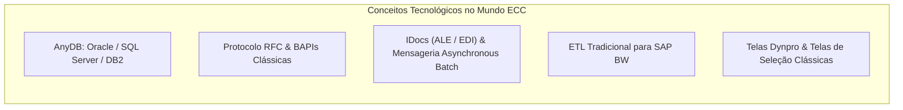
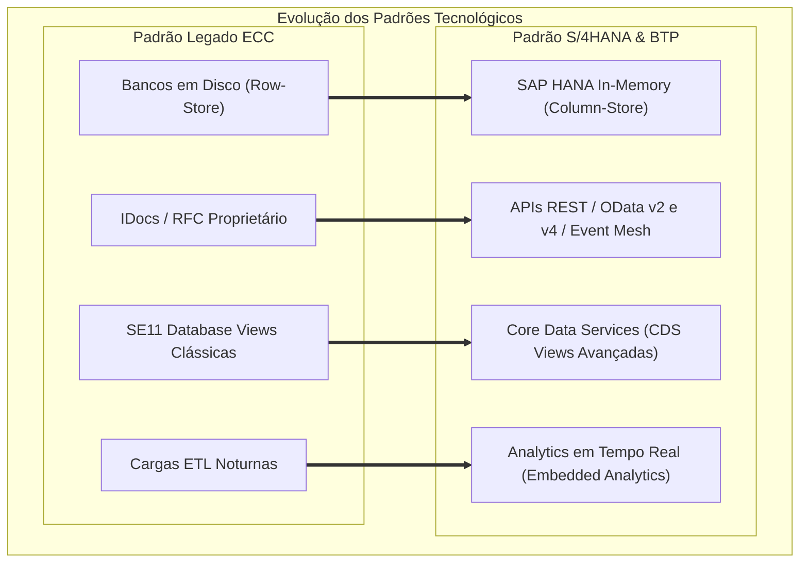

# Glossário Técnico e Conceitos Periféricos: Do Legado à Era Cloud

## 1. Contexto no SAP ECC (Como Funcionava Antes)

No ecossistema corporativo do SAP ECC 6.0 e R/3, o vocabulário de arquitetura de TI era dominado por conceitos de banco de dados relacional clássico, interfaces síncronas proprietárias e trocas de arquivos em lote:

---

## 2. O Que Mudou no SAP S/4HANA (Arquitetura e Conceito)

O S/4HANA substituiu os padrões proprietários e pesados do passado por tecnologias modernas abertas, padrões RESTful da internet e processamento de dados na camada mais próxima possível do hardware:

---

## 3. Glossário A-Z de Conceitos Essenciais

Abaixo está o guia de referência rápida dos principais termos periféricos e sua aplicação no contexto de transição para o S/4HANA:

### AnyDB
Termo cunhado pela SAP para se referir a **qualquer banco de dados relacional tradicional de terceiros** (Oracle Database, Microsoft SQL Server, IBM DB2, Sybase ASE, MaxDB) que suportava o SAP ECC. No S/4HANA, o suporte a AnyDB foi completamente encerrado em favor exclusivo do SAP HANA.

### BAPI (Business Application Programming Interface)
Métodos padronizados de chamada a objetos de negócios do SAP (implementados como Function Modules com RFC ativado na transação `BAPI`). No S/4HANA, muitas BAPIs continuam operacionais para compatibilidade, mas estão sendo gradualmente substituídas por **APIs OData/REST** documentadas no *SAP Business Accelerator Hub*.

### CDS Views (Core Data Services)
A espinha dorsal do desenvolvimento moderno no SAP HANA. São definições semânticas de dados criadas via código DDL (*Data Definition Language*) no Eclipse ADT que rodam diretamente na camada de banco de dados do HANA (*Code Pushdown*). Substituem com imensa superioridade as antigas *Database Views* da transação `SE11`.

### Clean Core
Estratégia de governança de software onde o núcleo do ERP S/4HANA é mantido estritamente aderente ao padrão da SAP, sem modificações de código standard. Quaisquer customizações e integrações devem ser implementadas usando extensibilidade homologada (*In-App Key-User*, *ABAP Cloud* ou *Side-by-Side* no SAP BTP).

### Compatibility Views
Visões de redirecionamento geradas pelo SAP HANA para que consultas antigas do tipo `SELECT * FROM bsis` continuem funcionando no S/4HANA, mesmo após a tabela física ter sido eliminada e seus dados transferidos para a `ACDOCA` ou `MATDOC`. **Atenção**: suportam apenas leitura (`SELECT`), nunca escrita (`INSERT`/`UPDATE`).

### DMO (Database Migration Option)
Funcionalidade do instalador oficial **SUM (Software Update Manager)** que permite realizar o upgrade da aplicação ECC e a migração física do banco AnyDB para o SAP HANA em um único passo consolidado de downtime.

### ETL (Extract, Transform, Load)
Processo de extração em lote de dados do ERP operacional para alimentar data warehouses analíticos (como o SAP BW ou datalakes). No S/4HANA, a necessidade de rotinas massivas de ETL é reduzida graças ao conceito de **Embedded Analytics** rodando em tempo real sobre a tabela `ACDOCA`.

### IDoc (Intermediate Document)
Formato de mensagem estruturada em texto proprietário da SAP utilizado há décadas para comunicação assíncrona entre sistemas via ALE/EDI. No S/4HANA, o IDoc continua funcionando para legados, mas cenários modernos de integração utilizam **APIs REST/OData** e mensageria orientada a eventos (**Event Mesh**).

### OData (Open Data Protocol)
Protocolo padrão aberto da Web baseado em REST/JSON/XML utilizado para comunicação entre a camada de apresentação (**SAP Fiori / SAPUI5**) e o back-end ABAP do S/4HANA. Opera sobre o protocolo HTTP/HTTPS padrão.

### RAP (ABAP RESTful Application Programming Model)
O framework de desenvolvimento oficial e arquiteturalmente recomendado para criar aplicações corporativas otimizadas para o SAP HANA, conectando CDS Views ao SAP Fiori e gerando serviços OData nativos.

### RFC (Remote Function Call)
Protocolo de comunicação proprietário da SAP para invocação de funções entre sistemas SAP ou aplicações externas via conector SAP JCo/NCo. Conexões RFC clássicas sem criptografia devem ser migradas para canais seguros baseados em HTTPS/Web Services ou *Cloud Connector*.

---

## 4. Impacto Prático na Migração e Armadilhas Reais de Projetos

### O Choque entre Arquiteturas de Integração
- **Equipes de Integração Presas ao Passado**: É comum ver desenvolvedores tentando criar dezenas de novos fluxos baseados em IDocs e arquivos `.csv` trafegando por pastas compartilhadas FTP em pleno projeto S/4HANA.
- **A Sobrecarga do Gateway OData**: APIs OData mal desenhadas (que solicitam milhões de registros sem paginação `$top` e `$skip`) podem sobrecarregar a memória do servidor de aplicação SAP Gateway.

### Armadilhas Reais de Projetos (*Gotchas*)

!!! danger "Armadilha 1: Conexões RFC Abertas sem Criptografia (SNC)"
    Muitas integrações legadas do ECC operavam via RFC sem autenticação robusta ou sem criptografia (*Secure Network Communications - SNC*). No S/4HANA, os requisitos de segurança e auditoria exigem que comunicações externas sejam autenticadas via certificados digitais, OAuth 2.0 e canais HTTPS seguros.

!!! warning "Armadilha 2: Confundir CDS Views com Database Views Clássicas"
    Tentar criar ou modificar CDS Views através do Dicionário de Dados clássico do SAP GUI (`SE11`) é impossível. O desenvolvimento de CDS Views exige o uso exclusivo do ambiente **Eclipse com o plugin ABAP Development Tools (ADT)**.

---

## 5. Tabela de Referências Cruzadas

### Links Internos na Wiki
- [O que é o S/4HANA e Modelos de Nuvem](../01-fundamentos/o-que-e-s4hana.md)
- [Arquitetura SAP HANA (In-Memory e Colunar)](../01-fundamentos/arquitetura-hana.md)
- [SAP BTP & Clean Core](../01-fundamentos/sap-btp-e-clean-core.md)
- [Universal Journal e ACDOCA](../02-de-para-tecnico/universal-journal-acdoca.md)

### Links Oficiais e Notas SAP
- [SAP Business Accelerator Hub: Catálogo Central de APIs OData e CDS](https://api.sap.com/)
- [OData Organization: Documentação Oficial do Padrão OData](https://www.odata.org/)
- [SAP Community: ABAP Core Data Services (CDS)](https://community.sap.com/topics/abap/cds)
