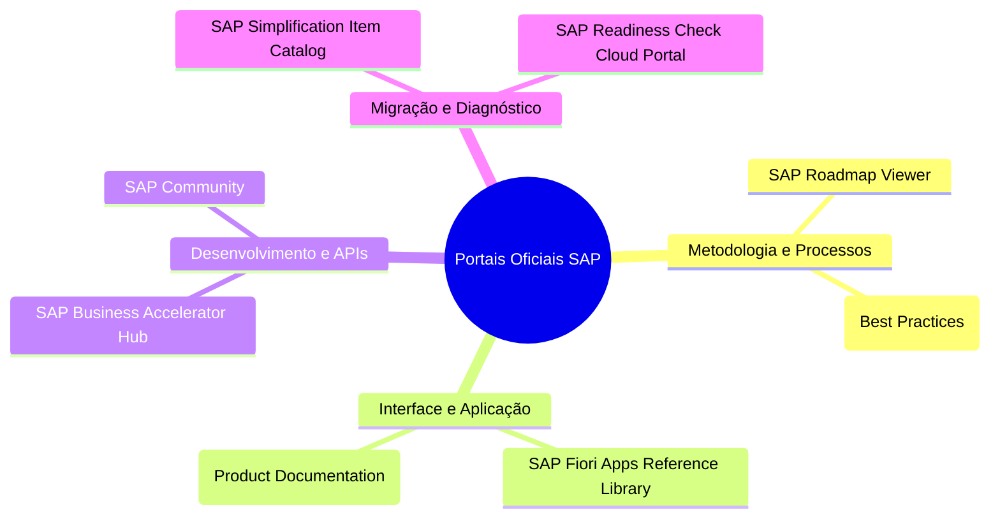

# Diretório Curado de Portais Oficiais, Notas Canônicas e Roadmaps SAP

## 1. Contexto no SAP ECC (Como Funcionava Antes)

No modelo tradicional do SAP ECC 6.0, as informações técnicas oficiais eram dispersas entre o antigo **SAP Service Marketplace (SMP)**, notas de suporte isoladas e manuais estáticos em PDF. A documentação sobre atualizações dependia de compêndios gigantescos de notas de correção (*Master Notes*) e da navegação manual no portal de suporte.

---

## 2. O Que Mudou no SAP S/4HANA (Arquitetura e Conceito)

Na era S/4HANA, a SAP unificou e modernizou seus canais de documentação, oferecendo catálogos interativos na nuvem, ferramentas de autoatendimento, repositórios de APIs públicas e roteiros visuais prescritivos. Abaixo está o diretório curado das ferramentas oficiais essenciais para o arquiteto e consultor funcional.

---

## 3. Diretório Oficial de Portais Essenciais

### 1. Diagnóstico e Migração Técnica
| Portal Oficial | URL / Acesso | Finalidade Principal no Projeto |
| :--- | :--- | :--- |
| **SAP Simplification Item Catalog** | [launchpad.support.sap.com/#/sic](https://launchpad.support.sap.com/#/sic/) | Pesquisa detalhada de todos os itens simplificados, transações descontinuadas e notas técnicas por release do S/4HANA. |
| **SAP Readiness Check Portal** | [me.sap.com/readinesscheck](https://me.sap.com/readinesscheck) | Painel em nuvem para visualização do diagnóstico completo da base ECC produtiva. |
| **SAP Software Center** | [me.sap.com/softwarecenter](https://me.sap.com/softwarecenter) | Download oficial de pacotes de instalação, patches, ferramentas SUM e componentes de banco SAP HANA. |

### 2. Processos de Negócio e Metodologia
| Portal Oficial | URL / Acesso | Finalidade Principal no Projeto |
| :--- | :--- | :--- |
| **SAP Roadmap Viewer** | [roadmapviewer.sap.com](https://roadmapviewer.sap.com/) | Metodologia prescritiva passo a passo do **SAP Activate** para cada tipo de transição (On-Premise, RISE, Cloud). |
| **SAP Process Navigator** | [me.sap.com/processnavigator](https://me.sap.com/processnavigator) | Catálogo oficial de **SAP Best Practices**, contendo diagramas de fluxo de negócio e scripts de teste prontos. |

### 3. Interface com o Usuário (UX) e APIs
| Portal Oficial | URL / Acesso | Finalidade Principal no Projeto |
| :--- | :--- | :--- |
| **SAP Fiori Apps Reference Library** | [fioriappslibrary.hana.ondemand.com](https://fioriappslibrary.hana.ondemand.com/sap/fix/externalViewer/) | Biblioteca com mais de 15.000 aplicativos Fiori, papéis de negócio (PFCG) e correspondência com transações legadas. |
| **SAP Business Accelerator Hub** | [api.sap.com](https://api.sap.com/) | Catálogo de APIs públicas OData/REST, eventos de negócio (Event Mesh) e CDS Views liberadas para Clean Core. |
| **SAP Help Portal** | [help.sap.com](https://help.sap.com/) | Documentação oficial completa de produtos, módulos, guias de administração e segurança do S/4HANA. |

---

## 4. Tabela Canônica de Notas SAP Obrigatórias de Migração

Todo arquiteto e consultor técnico deve conhecer e manter em seus favoritos as seguintes notas canônicas:

| Número da Nota SAP | Título Oficial | Importância Crítica no Projeto |
| :--- | :--- | :--- |
| **SAP Note 2758146** | *SAP Readiness Check for SAP S/4HANA - Composite Note* | Instalação e execução do Readiness Check no SAP ECC legado. |
| **SAP Note 2269324** | *Compatibility Scope Matrix for SAP S/4HANA* | Lista oficial de pacotes de compatibilidade e prazos de descontinuação. |
| **SAP Note 2265093** | *S4TWL - Business Partner Approach (CVI)* | Regras centrais e notas filhas para unificação de clientes e fornecedores. |
| **SAP Note 2270387** | *S4TWL - FIN: Data Model in S/4HANA Finance* | Explicação técnica detalhada da migração para o Universal Journal (`ACDOCA`). |
| **SAP Note 2206980** | *Material Inventory Management: Change of Data Model in S/4HANA* | Introdução da tabela `MATDOC` e simplificação de estoques em MM. |
| **SAP Note 2267306** | *S4TWL - SD Simplified Data Model* | Eliminação das tabelas de status `VBUK` e `VBUP` em Vendas. |
| **SAP Note 2932977** | *Release of ABAP Development Objects for ABAP Cloud* | Guia de governança de Clean Core e objetos liberados para desenvolvimento. |
| **SAP Note 2364916** | *DMO: Tips & Tricks for SAP HANA Migration* | Parâmetros de otimização de performance para o SUM com DMO. |

---

## 5. Tabela de Referências Cruzadas

### Links Internos na Wiki
- [O que é o S/4HANA e Modelos de Nuvem](../01-fundamentos/o-que-e-s4hana.md)
- [Universal Journal e ACDOCA](../02-de-para-tecnico/universal-journal-acdoca.md)
- [Business Partner e CVI](../02-de-para-tecnico/business-partner-cvi.md)
- [Metodologia SAP Activate](../03-estrategias-e-ferramentas/metodologia-sap-activate.md)
- [Kit de Ferramentas Técnicas](../03-estrategias-e-ferramentas/kit-ferramentas.md)
- [Glossário Técnico](glossario-e-conceitos.md)

### Links Oficiais da Comunidade
- [SAP Community - Tópicos Gerais de S/4HANA](https://community.sap.com/topics/s4hana)
- [SAP Community - Espaço de Arquitetura ABAP](https://community.sap.com/topics/abap)
- [SAP Community - Fiori e Experiência do Usuário](https://community.sap.com/topics/fiori)
