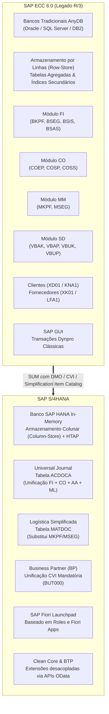
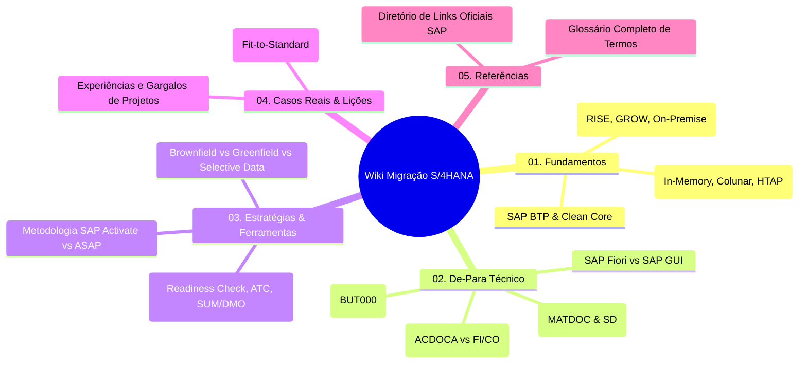

# Base de Conhecimento: Guia Definitivo de Migração SAP ECC para SAP S/4HANA

> **Seja bem-vindo(a) ao repositório de engenharia e arquitetura de transição SAP.**  
> Esta base de conhecimento foi projetada especificamente para consultores funcionais, arquitetos corporativos e desenvolvedores ABAP experientes em SAP ECC 6.0 que precisam liderar, desenhar ou executar a transição técnica e funcional para o **SAP S/4HANA**.

---

## 1. Visão Geral da Jornada de Migração

A mudança do **SAP ECC (ERP Central Component)** para o **SAP S/4HANA (Business Suite 4 SAP HANA)** não é apenas uma atualização de versão (*upgrade*) convencional como ocorria entre os releases do R/3 e os Enhancement Packages (EhP) do ECC. Trata-se de uma **transformação arquitetural completa**, que atinge desde a camada de persistência física (banco de dados in-memory colunar) até o modelo de dados de negócio, os paradigmas de desenvolvimento de software (*Clean Core*) e a interface com o usuário (*SAP Fiori*).

---

## 2. Mapa Mental e Estrutura da Wiki

A documentação está estruturada em cinco pilares fundamentais, permitindo uma curva de aprendizado acelerada e consultas cirúrgicas durante o projeto:

---

## 3. Matriz de Leitura Rápida por Especialidade

Dependendo do seu papel no projeto de migração, utilize a trilha recomendada abaixo:

| Papel no Projeto | Foco Principal | Leituras Recomendadas |
| :--- | :--- | :--- |
| **Consultor Funcional FI/CO** | Unificação contábil, eliminação de tabelas legadas e Ledger Universal | [Universal Journal (ACDOCA)](02-de-para-tecnico/universal-journal-acdoca.md)   [Business Partner & CVI](02-de-para-tecnico/business-partner-cvi.md)   [Checklist de Sobrevivência](04-casos-reais-e-licoes/checklist-sobrevivencia.md) |
| **Consultor Funcional MM/SD** | Mudança no controle de estoque, status de ordens e mestre de parceiros | [Logística Simplificada (MATDOC & SD)](02-de-para-tecnico/logistica-matdoc-sd.md)   [Business Partner & CVI](02-de-para-tecnico/business-partner-cvi.md)   [SAP Fiori vs SAP GUI](02-de-para-tecnico/fiori-vs-sap-gui.md) |
| **Desenvolvedor ABAP** | Código customizado (Z*), Compatibility Views, CDS Views e Clean Core | [Universal Journal (ACDOCA)](02-de-para-tecnico/universal-journal-acdoca.md)   [SAP BTP & Clean Core](01-fundamentos/sap-btp-e-clean-core.md)   [Kit de Ferramentas (ATC)](03-estrategias-e-ferramentas/kit-ferramentas.md) |
| **Arquiteto de Solução / PM** | Estratégia de cutover, governança, modelos de nuvem e metodologia | [O que é o S/4HANA](01-fundamentos/o-que-e-s4hana.md)   [Abordagens de Migração](03-estrategias-e-ferramentas/abordagens-migracao.md)   [Metodologia SAP Activate](03-estrategias-e-ferramentas/metodologia-sap-activate.md)   [Experiências de Clientes](04-casos-reais-e-licoes/experiencias-clientes.md) |

---

## 4. O Padrão de Engenharia Desta Wiki

Cada artigo técnico desta base de conhecimento segue rigorosamente o padrão arquitetural em 4 seções:
1. **Contexto no SAP ECC**: como a regra e a tabela eram tratadas no ambiente legado.
2. **O que mudou no SAP S/4HANA**: qual é a nova arquitetura física, lógica e conceitual.
3. **Impacto prático na migração e armadilhas reais de projetos**: o que realmente falha, onde o código Z quebra e como mitigar riscos no cutover.
4. **Tabela de referências cruzadas**: pontes diretas entre artigos desta wiki e documentação oficial da SAP (SAP Notes canônicas e Simplification Item Catalog).

---

## 5. Como Exportar Toda a Base para PDF ou Publicar na Web

- **Download do Manual em PDF Unificado (59 páginas)**: Você pode baixar a compilação completa desta base técnica para leitura offline e impressão:  
  [:fontawesome-solid-file-pdf: **Baixar Guia Definitivo em PDF (Edição Completa)**](assets/Guia_Definitivo_Migracao_SAP_S4HANA.pdf){ .md-button .md-button--primary }
- **Deploy Automatizado na Web (Cloudflare Pages)**: Este projeto está pronto para compilação com `mkdocs build` e publicação estática gratuita no Cloudflare Pages ou GitHub Pages.
- **Exportação Local Automatizada**: Execute `python export_pdf.py` na raiz do repositório para recompilar o PDF a qualquer momento com as últimas alterações da documentação.

---

!!! tip "Início Recomendado"
    Comece pela seção de fundamentos: [O que é o S/4HANA e Modelos de Nuvem](01-fundamentos/o-que-e-s4hana.md) e compreenda as diferenças fundamentais entre On-Premise, RISE com SAP (Private/Public Cloud) e GROW com SAP.
